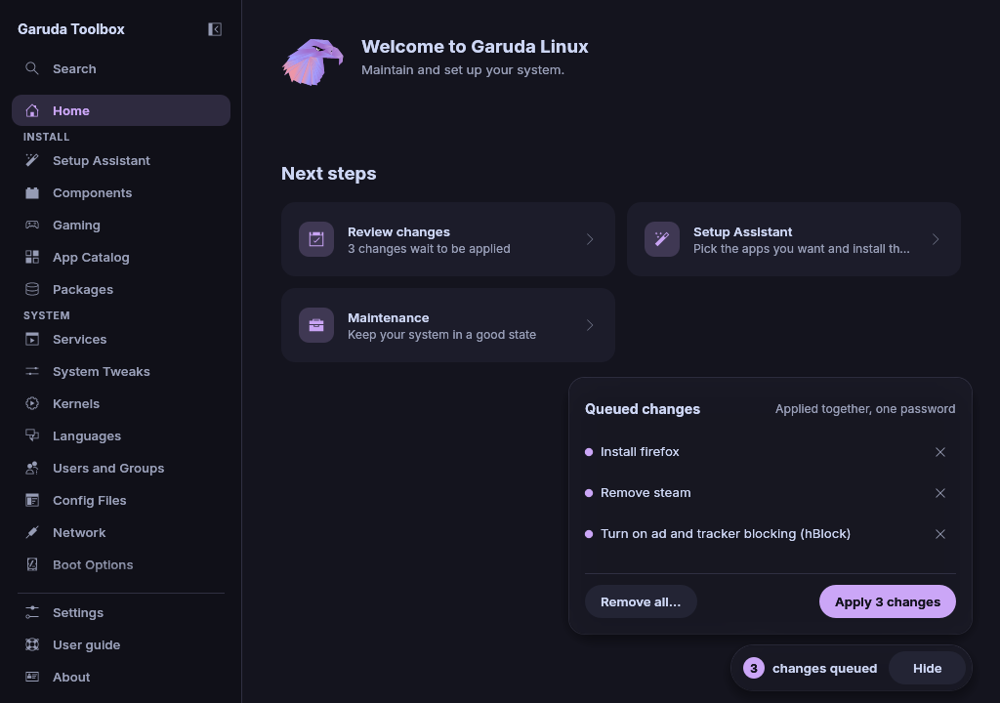

# Review and apply changes

Most changes in the app do not happen right away. They wait in a queue, so
you can collect several and apply them together with one password.

## See what waits

While changes wait, a pill at the bottom right of every page shows their
number, for example **2 changes queued**, with **Review** and **Apply**.
It sits in its own band below the page, so it never covers a control.

**Review** opens the list of queued changes above the pill. Each change is
one line in plain words, for example **Install firefox**. The × at the end
of a line drops that change. **Hide** closes the list again.

While the [Console](console.md) is open, the same count, **Review** and
**Apply** sit at the right of the Console's header instead.

While the window is open, a `garuda-toolbox` command that changes the queue
edits the window's queue and shows the note **The queue was changed from
the command line.** When 64 such commands wait for the window at once, the
next one fails with `the window has too many queue commands waiting`.

## Remove every waiting change

To start over, click **Remove all…** in the list and confirm the question,
for example **Remove all 3 queued changes?**, with **Remove all**. Nothing
is applied, and the pages show the system as it is again. **Keep them**
keeps the queue.

> **Note:** There is no undo for this. To get the changes back, make them
> again on their pages.

Waiting changes stay when you quit the app. They are there again on the
next start.

On that start, **Apply** waits until every page has checked the restored
changes against the system. A queued lock, account removal or group
change waits for the lock state of the accounts, a queued AUR build for
the package list of the AUR. The app reads both by itself. While it
waits, **Apply** is greyed out and its tooltip says what it waits for. If
that part cannot be read, remove the change from the list.

## Apply

1. Click **Apply** on the pill, or **Apply 3 changes** at the end of the
   list.
2. Enter your password when your desktop asks for it.

The [Console](console.md) opens over the page. Its step list shows every
step with its command, and the terminal shows what the programs print.
When everything ran, the Console's header says **All changes applied** and
the applied changes leave the queue. A step that found nothing to do, such
as a file that already is as wanted, shows **Nothing to do**, and the
header then says how many steps had nothing to do.

> **Note:** If a step fails, the steps after it do not run. The header says
> **Stopped before all changes were applied** and the failed step
> shows its exit code. The changes that did not run stay in the queue, so
> **Apply** runs them again once you fixed the cause.

A change whose steps did not all finish stays in the queue with the tag
**Did not finish**, even when part of it already shows on its page. For
example, a locale whose line in `/etc/locale.gen` was switched on while
`locale-gen` failed. The tag goes away once an apply runs all of the
change's steps. `garuda-toolbox queue apply` keeps such changes the same
way.

If you close the password dialog, nothing changes and the Console shows
**The password dialog was closed. Nothing was changed.**

> **Note:** The app never sees or stores your password. The desktop asks for
> it and remembers the approval itself for a few minutes, so applying again
> right away asks no second time.

## See also

- [The Console](console.md)
- [Maintenance](maintenance.md)
- [Troubleshooting](troubleshooting.md): when a password or a step fails
