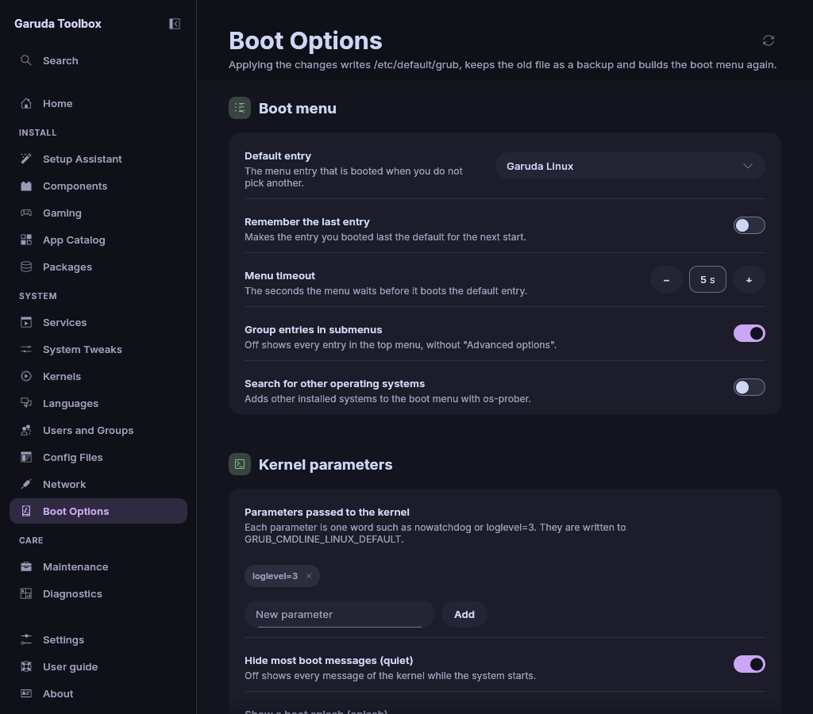

# Boot Options

**Boot Options** changes how GRUB starts your system: the entry it boots, how
long the menu waits, the parameters the kernel gets, the boot splash and the
look of the menu.

A changed setting shows **Changes with Apply** beside its name. Changes
wait in the queue until you apply them, see
[Review and apply changes](applying.md).

## Before you start

The page works on systems that boot with GRUB. It reads the settings from
`/etc/default/grub`. On a system without that file (systemd-boot, rEFInd,
Limine) it shows **GRUB is not the boot loader of this system** and offers
nothing to change.

> **Warning:** These settings decide whether and how your system starts. A
> wrong kernel parameter can keep it from booting. Know how to reach the GRUB
> menu (hold `Shift` or press `Esc` while the computer starts) and how to edit
> an entry there with `e` before you change parameters.

## What happens when you apply

1. The app changes only the values of the settings you queued in
   `/etc/default/grub`. Comments, the order of the lines and every other
   setting stay as they are. A setting that is commented out in the file is
   switched on in its place, a missing one is added at the end.
2. The file as it was before is kept as `/etc/default/grub.bak`.
3. `grub-mkconfig -o /boot/grub/grub.cfg` runs once and builds the boot menu
   from the file, however many settings you changed.
4. A new boot splash theme is set last, because it builds the initramfs (the
   small start-up system the kernel loads first) again.

To undo a change before you apply, set the old value again or remove the
change from the list behind **Review** on the changes pill. To undo it
afterwards, set the old value and apply once more, or copy
`/etc/default/grub.bak` back with the **Config Files** page and run
`grub-mkconfig -o /boot/grub/grub.cfg` as root.

## Choose the entry that boots by default

**Default entry** under **Boot menu** lists the entries of the boot menu.
Entries inside a submenu name it, for example
`Garuda Linux, with Linux linux-lts (in Advanced options for Garuda Linux)`.

1. Pick the entry.
2. Apply the queue.

The app writes the entry's id to `GRUB_DEFAULT`, so the choice still fits when
an update changes the order of the menu.

The boot menu (`/boot/grub/grub.cfg`) can usually be read by the administrator
only. The app reads only the titles and ids of the entries, after your
password. When that is refused, the list stays empty and the text
below it says so. **Read again** at the top right, or `F5`, asks once more.

An entry the file names but the menu does not have shows as written, with
`(not in the boot menu)` behind it.

### Coming from the Kernels page

**Set as default…** on an installed kernel of the [Kernels](kernels.md) page
opens this page with a note above the settings that names the kernel and
offers its entry. Nothing is queued yet:

- **Queue as default** queues the kernel's entry. Then apply the queue.
- **Do not change** closes the note and leaves the default as it is.
- Picking another entry in **Default entry** yourself queues that one, as
  always.

The note says so when the kernel already is the default, when the boot menu
has no entry for it, and when **Remember the last entry** is on (switch that
off first).

## Remember the last entry

Switch on **Remember the last entry** to make GRUB boot what you booted last.
The app sets `GRUB_SAVEDEFAULT=true` and `GRUB_DEFAULT=saved`. **Default
entry** then shows **The entry booted last** and cannot be changed.

Switching it off sets `GRUB_SAVEDEFAULT=false` and names an entry again: the
one the file named before, or the first one of the list.

## Change how long the menu waits

Set **Menu timeout** to the seconds the menu waits before it boots the default
entry, from 0 to 300. With 0 the menu does not wait at all.

## Show or hide submenus and other systems

| Switch                                 | On                                                    | Off                             |
| -------------------------------------- | ----------------------------------------------------- | ------------------------------- |
| **Group entries in submenus**          | Older kernels and fallback entries sit in a submenu   | Every entry is in the top menu  |
| **Search for other operating systems** | `os-prober` adds other installed systems (Windows, …) | Only this system is in the menu |

**Search for other operating systems** needs the `os-prober` package. Without
it `grub-mkconfig` finds no other system.

## Change kernel parameters

**Parameters passed to the kernel** under **Kernel parameters** lists the
words of `GRUB_CMDLINE_LINUX_DEFAULT`, one chip per parameter. The four
parameters with their own switch below show on the switches instead.

- To add one, type it into **New parameter** (for example `nowatchdog` or
  `loglevel=3`) and click **Add** or press `Enter`.
- To remove one, click the button with the cross on its chip. Its tooltip
  names the parameter.

A parameter is one word of letters, digits and `_ - . , : = / @ + % ! ~ ^ [ ]`.
Blanks, quotes, backslashes and dollar signs are refused, and the page says
why above the settings. This keeps a typing mistake from breaking the file,
which the system reads as a script.

A command line that already holds such characters (for example
`acpi_osi="Windows 2015"`) is shown as it is and not changed here. Edit
`/etc/default/grub` on the **Config Files** page instead.

Four common parameters have their own switch:

| Switch                                                  | Parameter                | What it does                                                       |
| ------------------------------------------------------- | ------------------------ | ------------------------------------------------------------------ |
| **Hide most boot messages (quiet)**                     | `quiet`                  | Off shows every kernel message while the system starts             |
| **Show a boot splash (splash)**                         | `splash`                 | Shows Plymouth's animation instead of text                         |
| **Turn off CPU mitigations (mitigations=off)**          | `mitigations=off`        | More speed on some processors, less protection against CPU attacks |
| **Enable the Magic SysRq key (sysrq_always_enabled=1)** | `sysrq_always_enabled=1` | Keeps the emergency key combinations switched on                   |

> **Warning:** **Turn off CPU mitigations (mitigations=off)** removes the
> protection against attacks such as Spectre and Meltdown. Switch it on only
> when you know why you want it.

## Use a boot splash

Switch on **Show a boot splash (splash)**. When the `plymouth` package is not
installed, its installation is queued with the parameter. Switching the splash
off again before you apply takes that back.

With the splash on, **Boot splash theme** under **Appearance** lists the
installed Plymouth themes:

1. Pick a theme.
2. Apply the queue.

The app runs `plymouth-set-default-theme` with the theme, then builds the
initramfs again with `dracut-rebuild`, or with `mkinitcpio -P` on a system
without it. That takes a while.

Right after Plymouth was queued the list is empty. Apply first, then choose a
theme.

In a virtual machine the page shows a warning while the splash is on: the
splash works there in a limited way.

## Change the look of the GRUB menu

Under **Appearance**:

- **GRUB background picture** is a PNG, JPEG or TGA picture behind the menu
  (`GRUB_BACKGROUND`).
- **GRUB theme** is the `theme.txt` file of a GRUB theme (`GRUB_THEME`),
  usually below `/usr/share/grub/themes`. A theme brings its own background.

For each of them:

1. Click **Choose…** and pick the file in your desktop's file dialog.
2. Apply the queue.

The file dialog comes from the desktop portal (`xdg-desktop-portal`). On a
desktop without one, **Choose…** opens nothing.

**Use none** in the **⋯** menu beside **Choose…** comments the setting out
in the file, so GRUB uses none.

Garuda's own GRUB theme reads its background from another variable,
`GRUB_MENU_PICTURE`, and a fresh Garuda system sets only that one. The page
then shows that picture with the note **Set by the GRUB theme
(GRUB_MENU_PICTURE). Choose a picture to replace it.** A picture you choose
is written to `GRUB_BACKGROUND` and the theme's line stays as it is.
**Use none** is not offered for the theme's picture. After you used it on a
picture of your own, the theme's picture shows again.

GRUB reads the file while the computer starts, before your home folder may be
unlocked. Pick a file on a partition GRUB can read, for example below
`/usr/share` or `/boot`.

## On other systems

- Other Arch based systems: the page works wherever GRUB is the boot loader.
  Garuda's own GRUB theme and its settings are ordinary lines of the file.
- Live ISO: the page works on the files of the live system itself. It does
  not change an installed system from the live ISO.

## See also

- [Review and apply changes](applying.md)
- [Config Files](config-files.md)
- [Kernels](kernels.md)
- [The Console](console.md)
- [The command line](cli.md)
