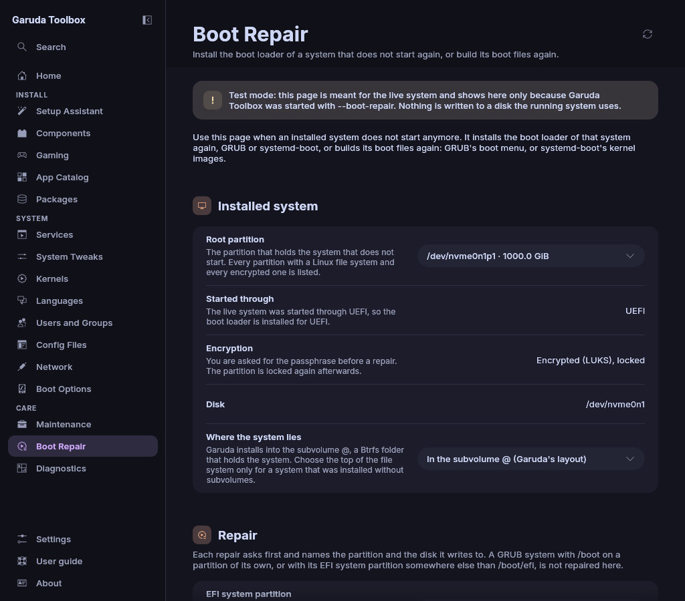

# Boot Repair

**Boot Repair** helps when an installed system no longer starts. From the
live system it installs the GRUB boot loader of that system again, or writes
its boot menu again.

> **Warning:** A repair writes a boot loader to a disk. It replaces the boot
> loader that is there now, which cannot be undone from this page. Read the
> dialog before you confirm: it names the partition and the disk that are
> written. Use the page only for a system that does not start, and keep a
> backup of what you cannot lose.

## Before you start

- Start the computer from the Garuda live medium. **Boot Repair** shows in the
  sidebar of the live system only. On an installed system it shows only
  with `--boot-repair`, see [Test mode](#test-mode).
- Start the live medium the same way the installed system starts. A system
  that was installed through UEFI needs the live medium started through UEFI,
  and a system installed the legacy way needs it started the legacy way. The
  page shows which one it found under **Started through**.
- The live system needs `lsblk`, `grub-install` and `cryptsetup`. The Garuda
  live medium has them. Without one of them the page shows **Boot repair
  cannot work on this system**, names the missing programs and offers nothing.
- For an encrypted system you need its passphrase.

The page repairs systems that boot with GRUB and keep `/boot` on the root
partition. Two layouts are not supported and are refused before anything is
written:

- `/boot` on a partition of its own,
- an EFI system partition that the system mounts somewhere else than
  `/boot/efi`.

## Choose the system

1. Open **Boot Repair** in the sidebar.
2. Pick the partition of the system under **Root partition**. The list holds
   every partition with a Linux file system and every encrypted partition,
   each with its label, size and file system.

Below the list the page shows what it found:

| Field                     | Meaning                                                                                      |
| ------------------------- | -------------------------------------------------------------------------------------------- |
| **Started through**       | **UEFI** or **BIOS (legacy)**: how the live system was started, and so how GRUB is installed |
| **Encryption**            | **Not encrypted**, **Encrypted (LUKS), locked** or **Encrypted (LUKS), unlocked**            |
| **Disk**                  | The disk the partition lies on                                                               |
| **Where the system lies** | Only for btrfs and for locked partitions, see below                                          |

Garuda installs into the btrfs subvolume `@`, so **Where the system lies** is
set to **In the subvolume @ (Garuda's layout)**. Choose **At the top of the
file system** only for a system that was installed on btrfs without
subvolumes, or for an encrypted partition that holds another file system.

**Read again** (the round arrow at the top, or `F5`) reads the disks again, for
example after you plugged in a disk or unmounted a partition.

## Reinstall GRUB

Use this when the computer does not find a boot loader at all, shows a
`grub rescue>` prompt, or lost its boot entry after a firmware update.

1. Choose where the boot loader goes:
   - started through UEFI: the partition under **EFI system partition**,
   - started the legacy way: the disk under **Disk for the boot loader**.
     Choose the disk the computer starts from.
2. Click **Reinstall GRUB…**.
3. Read the dialog. It names the partition or disk GRUB is written to and the
   system it is installed for.
4. For a locked system, enter its passphrase.
5. Click **Reinstall GRUB** and enter an administrator's password.

The repair installs GRUB and then writes the boot menu again. On a UEFI system
the boot entry is called `Garuda` in the firmware's boot menu.

## Generate the boot menu again

Use this when GRUB starts but its menu is empty, lacks a kernel you installed
or still lists one you removed.

1. Click **Generate boot menu…**.
2. Read the dialog and, for a locked system, enter its passphrase.
3. Click **Generate boot menu** and enter an administrator's password.

Only `/boot/grub/grub.cfg` of the chosen system is written. The boot loader
itself stays as it is.

## What a repair does

Every repair runs at once in the [Console](console.md), which shows each
command. Nothing is added to the queue.

1. The app checks the devices: each must be a real disk or partition of the
   kind the repair needs, and none may lie on a disk the live system uses.
2. An encrypted partition is unlocked with your passphrase.
3. The system is mounted below `/run/garuda-toolbox/boot-repair/root`,
   together with `/dev`, `/proc`, `/sys` and `/run` and, for UEFI, the EFI
   system partition.
4. The app checks that the mounted partition holds an installed system with
   GRUB and a kernel. A data partition or a wrong layout stops here.
5. The installed system's own programs run inside it: `grub-install` when
   GRUB is reinstalled, then `dracut-rebuild` (or `mkinitcpio -P` where it
   is missing) to build every initramfs again, then `grub-mkconfig`.
6. Everything is unmounted again and the encrypted partition is locked, also
   when a step failed or you cancelled.

The passphrase goes to `cryptsetup` directly. It is not shown in the Console,
not written to the log and not kept in any file.

Afterwards the page says how it went:

| Message                                                                                                             | Meaning                                             |
| ------------------------------------------------------------------------------------------------------------------- | --------------------------------------------------- |
| **The repair finished without an error. Restart the computer without the live medium to try the installed system.** | Every command succeeded                             |
| **The repair failed. Nothing stays mounted or unlocked. The Console shows which command failed.**                   | A command failed. **Show Console** opens the output |
| **Another task was running, so the repair did not start. Try again when it has finished.**                          | The Console was busy with another run               |

## When a system cannot be repaired here

- **The running system uses the disk of this partition, so it cannot be
  repaired from here.** Something from that disk is mounted, for example
  because you opened it in the file manager. Unmount it and click
  **Read again**. The disk the live system itself runs from is never written
  to.
- **No EFI system partition was found on a disk that is free, so GRUB cannot
  be installed. The boot menu can still be written again.** The live system
  was started through UEFI, but no free disk has an EFI system partition.
  A system that was installed the legacy way needs the live medium started
  the legacy way.
- **No installed system was found**: no disk holds a partition with a Linux
  file system or an encrypted partition.
- The Console says the partition has no `/usr/bin/grub-install`: the partition
  holds no installed system with GRUB, or **Where the system lies** names the
  wrong place.
- A volume inside an encrypted partition (LVM on LUKS) only shows once the
  partition is unlocked. Unlock it in the file manager or with
  `cryptsetup open`, then click **Read again**.

For anything this page does not cover, **Repair an installed system** on
**Home** opens a root shell inside the installed system, see
[Home and system status](home.md#on-the-live-iso).

## Test mode

Starting the app with `garuda-toolbox --boot-repair` shows the page on an
installed system too, for testing. A banner says so: **Test mode: this page is
meant for the live system and shows here only because Garuda Toolbox was
started with --boot-repair. Nothing is written to a disk the running system
uses.** A system on a disk that is in use cannot be repaired there either.

## See also

- [Boot Options](boot-options.md)
- [The Console](console.md)
- [Home and system status](home.md)
- [The command line](cli.md)
