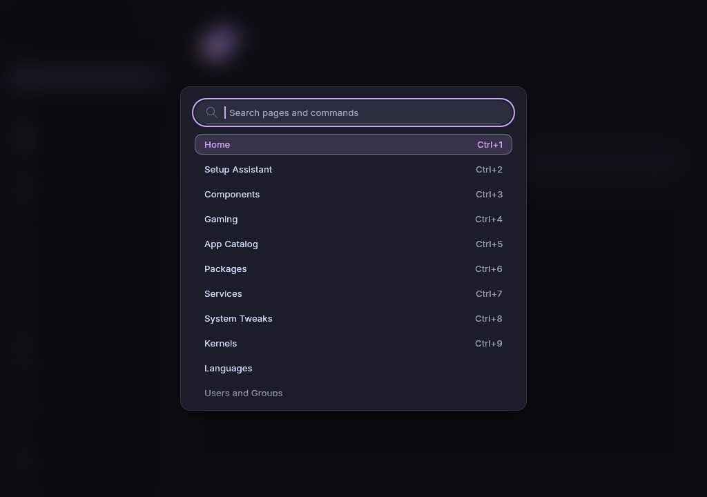

# Command palette and shortcuts

The command palette finds pages, commands, Maintenance operations and the
apps of **App Catalog** by name, so you can reach them with the keyboard
alone.

## Find something with the command palette

1. Press `Ctrl+k`, or click **Search** at the top of the sidebar, and type.
2. Move to the entry you want with the `Up` and `Down` keys and press
   `Enter`, or click it.

Press `Esc` to close the palette without choosing.

An entry shows when its name holds what you typed. Upper and lower case do
not matter. Apps and Maintenance operations show only once you type, because
there are too many to list. The list shows at most 50 entries, so type more when
you do not see yours. When nothing fits, the list stays empty.

### What an entry does

| Entry                   | Shown at the right       | Choosing it                                               |
| ----------------------- | ------------------------ | --------------------------------------------------------- |
| A page, such as Kernels | its shortcut, if any     | Opens the page                                            |
| A command               | its shortcut, if any     | Runs it, see below                                        |
| A Maintenance operation | **Maintenance** and tab  | Opens **Maintenance** on the tab that holds the operation |
| An app, such as Firefox | **App** and its category | Opens **App Catalog** with the app on top                 |

The commands are **Apply changes**, **Review changes** (only while changes
wait), **Remove all changes**, **Search this page**, **Help for this page**,
**Toggle sidebar**, **Toggle console** and **Quit**. They run at once, as
their shortcut would. **Remove all changes** asks first. Pages, operations
and apps only open. They never change anything by themselves.

### Keys in the palette

| Key          | Does                                  |
| ------------ | ------------------------------------- |
| `Up`, `Down` | Moves one entry, wrapping at the ends |
| `Enter`      | Takes the marked entry                |
| `Esc`        | Closes the palette                    |

## Keyboard shortcuts

These keys work on every page.

| Shortcut             | Does                                                  |
| -------------------- | ----------------------------------------------------- |
| `Ctrl+k`             | Opens the command palette                             |
| `Ctrl+Enter`         | Applies the queued changes                            |
| `Ctrl+b`             | Shows or hides the page names in the sidebar          |
| `Ctrl+j`             | Shows or hides the **Console**                        |
| `Ctrl+f`             | Puts the cursor into the search of the open page      |
| `Ctrl+1` to `Ctrl+9` | Opens the first nine pages of the sidebar             |
| `F5`                 | Reads the open page again, as its **Read again** does |
| `F1`                 | Opens the [User guide](guide.md) on the open page     |
| `Ctrl+q`             | Quits the app. Queued changes are kept                |
| `Ctrl+Tab`           | Leaves the terminal in the **Console**                |

`F5` does nothing on a page without **Read again**.

> **Note:** While the terminal of the **Console** has the keyboard focus,
> keys go to the running program instead. An editor that runs there needs
> them. Press `Ctrl+Tab` first to leave the terminal.

The **Setup Assistant** has two more: `Alt+Right` goes to the next step and
`Alt+Left` goes back.

## See also

- [The Console](console.md)
- [Maintenance](maintenance.md)
- [App Catalog](discover.md)
- [Settings and About](settings.md)
