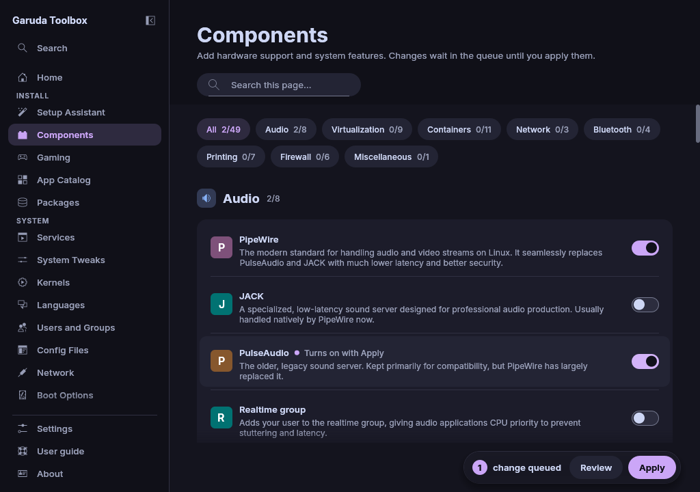

# Components

**Components** adds support for hardware and features: audio,
virtualization, containers, network, Bluetooth, printing and scanning,
firewalls, and the Garuda Nix Subsystem.

## How it works

Each row is one thing: a package, a system service or a group your
account belongs to. A switch that is on means it is on.

- Turn a row's switch on or off, or click the row, or press `Space` on it.
  Nothing changes yet: the change goes into the queue and the row says
  **Turns on with Apply** or **Turns off with Apply**.
- Flip it back to take the change out of the queue.
- Changes wait in the queue until you apply them, see
  [Review and apply changes](applying.md).

Packages are installed with pacman and removed together with the
dependencies nothing else needs. Services are enabled and started at once.
Group changes take effect at your next login. A group row follows the rules
of the [Users and Groups](users.md#what-the-page-refuses) page and says
above the rows when it refuses a click. The administrator groups `wheel` and
`sudo` have no row. They are changed on Users and Groups only.

The chips above the rows show one section at a time. **All** shows every
section. Type in **Search this page…** to keep only the rows whose name or
description holds the text.

## Entries that need another one

Some rows depend on others: the Docker service needs Docker, and Distrobox
needs Docker or Podman. The switch of such a row stays greyed out and the
row says **Needs …** or **Needs one of: …** until what it needs is on or
queued.

When you turn a needed row off, the dependent rows that no longer have what
they need leave the queue too, so an apply never enables a service whose
package is missing. A row that is already on can always be turned off.

A `-git` build of a package counts as installed, and turning the row off
removes that build.

## When the state of entries could not be read

A warning at the top of the page says how many entries it concerns, for
example "The state of 12 entries could not be read, so their switches may
show the wrong state". The app could not read that part of the system, for
example the package list on a system without pacman. You can still queue a
change. Click **Read again** in the warning to read the system again.

## Why a row is missing

Package rows only show when the repositories in `/etc/pacman.conf` offer
the package or it is installed already, so a row never offers what pacman
cannot install. Service, group and setting rows always show. See
[Why some apps are missing](discover.md#why-some-apps-are-missing).

## See also

- [Gaming](gaming.md)
- [Review and apply changes](applying.md)
- [Services](services.md)
- [The command line](cli.md)
