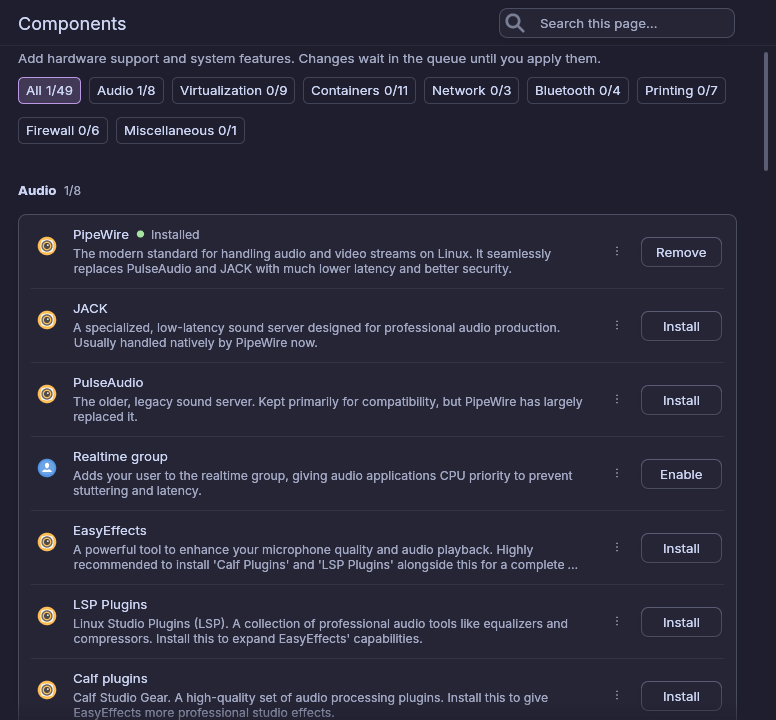

# Components

**Components** adds support for hardware and features: audio,
virtualization, containers, network, Bluetooth, printing and scanning,
firewalls, and the Garuda Nix Subsystem.

## How it works

Each row is one thing: a package, a system service or a group your
account belongs to.

- A package row has a button. **Install** queues the package, an installed
  package says **Installed** and offers **Remove**. The row then says
  **Installs with Apply** or **Removes with Apply**, and the button reads
  **Take back**.
- A service or group row has a button too. **Enable** queues turning it
  on, a row that is on offers **Disable**. The row says **Turns on with
  Apply** or **Turns off with Apply**. Click the button again to take the
  change out of the queue.
- `Space` on a selected row does what its button does.
- The **⋯** button of a row holds **Open website** where the entry has one
  and **Copy name**.
- Changes wait in the queue until you apply them, see
  [Review and apply changes](applying.md).

A description longer than two lines ends in "…". Point at it to read it
whole.

Packages are installed with pacman and removed together with the
dependencies nothing else needs. Services are enabled and started at once.
Group changes take effect at your next login. A group row follows the rules
of the [Users and Groups](users.md#what-the-page-refuses) page and says
above the rows when it refuses a click. The administrator groups `wheel` and
`sudo` have no row. They are changed on Users and Groups only.

The chips above the rows show one section at a time. **All** shows every
section. Type in **Search this page…** to keep only the rows whose name or
description holds the text. When the picked chip has no match but other
sections do, the page names the section and offers **Show all** with the
number of matches. It shows every section and keeps the search.

## Entries that need another one

Some rows depend on others: the Docker service needs Docker, and Distrobox
needs Docker or Podman. The button of such a row stays greyed out and the
row says **Needs …** or **Needs one of: …** until what it needs is on or
queued.

When you turn a needed row off, the dependent rows that no longer have what
they need leave the queue too, so an apply never enables a service whose
package is missing. A row that is already on can always be turned off.

A `-git` build of a package counts as installed, and turning the row off
removes that build.

## When the state of entries could not be read

A warning at the top of the page says how many entries it concerns, for
example "The state of 12 entries could not be read, so their switches may
show the wrong state". The app could not read that part of the system, for
example the package list on a system without pacman. The chips and section
headings then count "?/8" instead of how many are on. You can still queue a
change. Click **Read again** in the warning to read the system again.

## Why a row is missing

Package rows only show when the repositories in `/etc/pacman.conf` offer
the package or it is installed already, so a row never offers what pacman
cannot install. Service, group and setting rows always show. See
[Why some apps are missing](discover.md#why-some-apps-are-missing).

## See also

- [Gaming](gaming.md)
- [Review and apply changes](applying.md)
- [Services](services.md)
- [The command line](cli.md)
