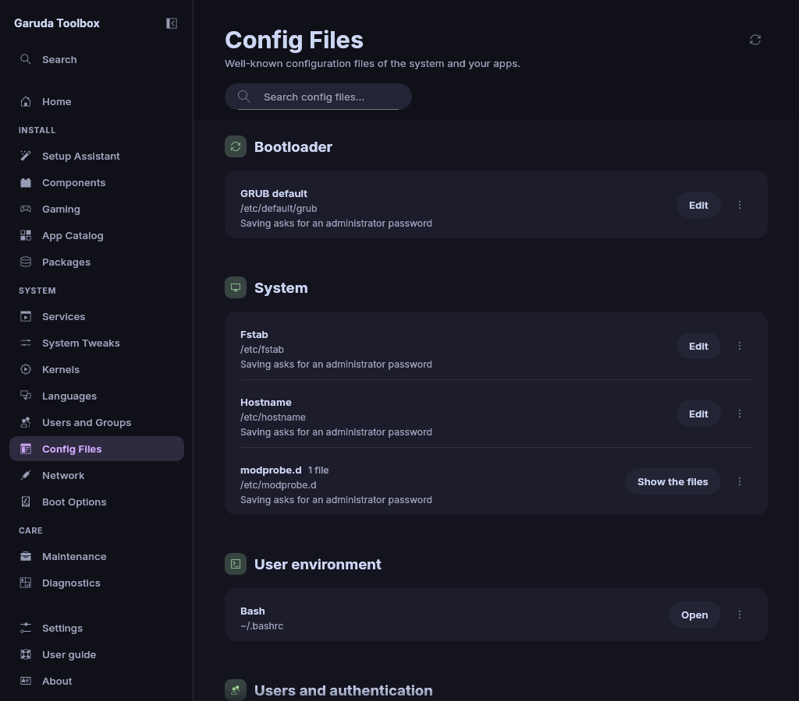

# Config Files

**Config Files** lists well-known configuration files of your system and your
apps, and opens them for editing.

The page shows only files that exist on your system, grouped into sections
such as Audio, Bootloader, Network and System. It has three kinds of files:

- Files in your home folder, such as `~/.bashrc`, are edited in the
  [Console](console.md) and saved with your own rights, without a password.
- Files that belong to the system, such as `/etc/fstab`, are edited in the
  [Console](console.md) and saved with an administrator's password. These rows
  say **Saving asks for an administrator password**.
- A few system files are only shown, because whoever changes them decides who
  may administer the system or what runs as root. **View** shows their text
  (see [Files that are only shown](#files-that-are-only-shown)).

No editor ever runs as root. You edit a private copy of the file, the app
shows you what changed, and only then is the file replaced.



## Before you start

Editing a file needs a terminal editor. The app uses the editor named
in `$VISUAL` or `$EDITOR` when it is one of micro, nano, vim, nvim, vi, helix
(`hx`), emacs, ne, joe or mcedit. Anything else in these variables is ignored.
Without a usable choice the app takes the first installed one of micro, nano
and vi. The app looks for the editor in `/usr/bin` first, then in the
folders of your `$PATH`. Garuda Linux ships micro.

## Find a file

- Type in the search field. The search looks at names, paths, descriptions and
  the files of folders, for example `grub`, `/etc/pacman` or `kwinrc`.
- **Read again** (the round arrow at the top, or `F5`) looks for the files of
  the list on your system again, for example after you installed a program.
  A search that finds nothing offers **Clear search**.

Each row shows the name, the path and at most one status line, such as who
may save it. Hover over a row to see what the file is for and, for a link, the
file it leads to. **Open wiki page** in the **⋯** menu at the right of the
row opens the matching page of the Arch wiki in your browser. For a file of
your home folder the menu also has **Open in app**. A screen
reader names the menu button `More actions for <name>`.

## Open a folder of files

Some rows are folders, such as `/etc/modprobe.d` or `~/.config/systemd/user`.
They show how many files they hold.

1. Click **Show the files** in the row (or select the row and press `Space` or
   `Enter`). **Hide the files** hides them again.
2. The files of the folder appear below it, each with its own **Edit**
   or **View** button. Where the folder has a wiki page, each file
   has the **⋯** menu with **Open wiki page** too. What the files are for is
   said once, on the row of the folder (screen readers read it on every
   file).

Folders without files are not listed, and only the files directly in the
folder are shown.

## Edit a file from your home folder

Click **Edit** in its row (or select the row and press `Enter`). It works like
[Edit a system file](#edit-a-system-file), with two differences:

- No password dialog appears: **Save** writes the file with your own rights.
- The previous version is kept as
  `~/.local/state/garuda-toolbox/backups/<path>`, readable by you alone.

A file that is a link, for example one a dotfile manager keeps, is written
where the link leads, and the link stays.

To use a graphical editor instead, choose **Open in app** in the **⋯** menu of
the row. The file opens in the default app of your desktop for that file type,
as if you had opened it from the file manager.

## Edit a system file

1. Click **Edit** in the row of the file.
2. When your account may not read the file (for example `/boot/grub/grub.cfg`),
   a password dialog asks for an administrator. Most files in `/etc` can be read
   without one.
3. The **Console** opens with your editor on a copy of the file. Change what
   you want, save and quit the editor.
4. The page comes back with the dialog `Save the changes to <file>?`. It shows
   every changed line with a few lines around it, under a heading such as
   **Lines 3 to 6**: added lines start with `+`, removed lines with `-`. It
   also names the file that will be written when that is another one (see
   [Files that are links](#files-that-are-links)).
5. Click **Save**. A password dialog asks for an administrator, and the
   Console shows the write.

When it worked, the page says `Saved <file>. The previous version is kept as
<backup>.`

The other buttons of the dialog:

| Button            | What it does                                                       |
| ----------------- | ------------------------------------------------------------------ |
| **Edit again**    | Opens the editor on your copy again, with your changes in it       |
| **Discard…**      | Asks **Discard your edits?**, then drops them and removes the copy |
| **Compare again** | After a failed save: shows your edit against the file as it is now |

The × at the top right is **Close and keep the edits**.

Closing the dialog keeps your changes. The page then says that they wait for
your review, and **Review changes** opens the dialog again.

When you quit the editor without changing anything, the page says that the
file was not changed, and nothing is written.

> **Warning:** A saved system file takes effect like any edit as root. A wrong
> line in `/etc/fstab` can keep the system from starting, and a wrong line in
> `/etc/default/grub` can hide the boot menu. Check the changes in the dialog
> before you click **Save**. The previous version is kept (see below).

### Files that are links

Some system files are links to another file. A distribution or an
administrator may keep `/etc/app.conf` as a link to `/etc/app/real.conf`, for
example. Such a row shows `Link to <target>`, the file the link leads to, as its
status line, or in its tooltip when the status line says something else.

Editing a link edits that file, as an editor run by an administrator would:

- **Edit** opens the text of the target.
- The dialog says `<file> is a link. Saving writes the file it leads to,
<target>. The link itself stays as it is.`
- **Save** replaces the target in its own folder. The link is not changed.
- The previous version is kept under the path of the target, not of the link.

A link is followed only to a file the app would also edit directly, which is
a file in `/etc`, `/boot/grub`, `/usr/share/grub/themes` or
`/usr/share/icons/default`. Other links have no **Edit** button, and the row
says why:

| What the row says                                                                                               | What it means                                                                                                                                                                                                                     |
| --------------------------------------------------------------------------------------------------------------- | --------------------------------------------------------------------------------------------------------------------------------------------------------------------------------------------------------------------------------- |
| `Not edited here: the link leads out of the system's config folders, to a file of a package or a generated one` | The target is a file a package owns (`/etc/os-release` leads to `/usr/lib/os-release`), a file a program writes anew (`/etc/resolv.conf` leads into `/run` with systemd-resolved) or a file somewhere else, such as a home folder |
| `Not edited here: the link leads to no file`                                                                    | The target does not exist                                                                                                                                                                                                         |
| `Not edited here: the link leads to a folder or another thing that is no file`                                  | The target is not a regular file                                                                                                                                                                                                  |

Change such a setting where it is made: with the program that writes the file,
or with a file of your own in `/etc` in place of the link.

### While the editor is open

One file can be edited at a time, and the **Edit** buttons of the other rows
are off meanwhile. The page shows which file is open, with two buttons:

- **Show Console** goes back to the editor.
- **Cancel edit** stops the editor and removes the copy. Nothing is written.

### Where the previous version is kept

Every save keeps the file as it was before in
`/var/lib/garuda-toolbox/backups`, under its own path: the backup of
`/etc/fstab` is `/var/lib/garuda-toolbox/backups/etc/fstab`. Only root can
read the backups. One backup is kept per file, and the next save of the same
file replaces it. For a link it is the path of the file that was written: the
backup of `/etc/app/real.conf`, not of the link `/etc/app.conf`. The dialog
and the page name it.

To go back, copy the backup over the file as root, for example:

```console
# cp /var/lib/garuda-toolbox/backups/etc/fstab /etc/fstab
```

The backups are not next to the files on purpose. Programs read every file in
folders such as `/etc/modprobe.d` or `/etc/grub.d`, and a backup there would
count as a second configuration.

### What a save keeps and what it refuses

- The file keeps its owner, its group and its permissions.
- The file is replaced in one step, so a crash leaves either the old or the
  new file, never half of one.
- A link stays a link. The file it leads to is replaced.
- When the file changed on disk after you opened it (a package update, another
  editor), the save is refused and the file stays as it is. Your edit is kept:
  the dialog opens again, and **Compare again** shows your edit against the
  file as it is now. Then **Save** it, or use **Edit again** to bring the
  other changes in.

## Files that are only shown

These files and folders are listed with their wiki page, but have no **Edit**
button. Their rows say `Only shown here: it decides who may administer the
system or what runs as root` and offer **View** instead (see
[View a file that is only shown](#view-a-file-that-is-only-shown)).

| File or folder                                                                                | What a change there does                                     |
| --------------------------------------------------------------------------------------------- | ------------------------------------------------------------ |
| `/etc/passwd`, `/etc/group`                                                                   | Creates accounts or makes one an administrator               |
| `/etc/sudoers`, `/etc/pam.d`                                                                  | Decides who may become root and how logins are checked       |
| `/etc/cron.d`, `/etc/cron.daily`, `/etc/cron.hourly`, `/etc/cron.monthly`, `/etc/cron.weekly` | Runs programs as root on a schedule                          |
| `/etc/systemd/system`, `/etc/udev/rules.d`, `/etc/pacman.d/hooks`                             | Runs programs as root at boot, for a device or for a package |

A mistake in one of them can lock everybody out of the system, and a single
save there gives whatever the file names the rights of root. Use
[Users and Groups](users.md) for accounts and groups, and a terminal with
`sudo` (`sudo visudo` for `/etc/sudoers`) for the rest.

### View a file that is only shown

1. Click **View** in the row of the file (or select the row and press
   `Enter`).
2. When your account may not read the file (for example `/etc/sudoers`), a
   password dialog asks for an administrator. `/etc/passwd` and `/etc/group`
   can be read without one.
3. A dialog **The text of `<file>`** shows it. It says `This file decides
who may administer the system or what runs as root, so it is only shown
here. Change it in a terminal with sudo.`

The text cannot be changed in the dialog. Select a part of it with the mouse,
or with `Shift` and the arrow keys, and copy it with `Ctrl+c`.
**Copy all** copies the whole text to the clipboard. **Close** or `Esc`
closes the dialog, and the text goes with it. Nothing is written and
nothing is queued.

When the row is a link, the dialog shows the text of the file the link leads
to and says `<file> is a link. This is the text of the file it leads to,
<target>.` A link out of the system's configuration folders has no **View**
button, as it has no **Edit** button elsewhere (see
[Files that are links](#files-that-are-links)).

When the text cannot be shown, the dialog says why instead:

| What the dialog says                                                | Why                                                                  |
| ------------------------------------------------------------------- | -------------------------------------------------------------------- |
| `… the password dialog was closed`                                  | You closed the password dialog. Click **View** again                 |
| `… the password dialog was closed or the password was not accepted` | Cancel in KDE Plasma's dialog, a wrong password, or no administrator |
| `… is no text file, so it cannot be shown here`                     | The file is not UTF-8 text                                           |
| `… is larger than 1 MiB, which is too large to show here`           | Larger files are not handed out                                      |

## Files that cannot be edited here

| What you see                                 | Why                                                                                                      |
| -------------------------------------------- | -------------------------------------------------------------------------------------------------------- |
| `Only shown here: …` in the row              | See [Files that are only shown](#files-that-are-only-shown)                                              |
| `Not edited here: …` in the row              | The file is a link to something the app does not edit. See [Files that are links](#files-that-are-links) |
| `… was replaced by a link while it was read` | The file changed into a link in that moment. Click **Read again** and try again                          |
| A file is missing from the list              | It does not exist on your system, or it is in a folder your account may not look into                    |
| `… is larger than 1 MiB`                     | Larger files are not handed out                                                                          |
| `… is no text file`                          | The file is not UTF-8 text                                                                               |
| `No terminal editor is installed`            | Install micro, nano or vi                                                                                |
| `Another task runs in the Console`           | Wait until it has finished, then try again                                                               |

`/etc/shadow` and `/etc/gshadow` are not on the list. They hold the password
hashes, which never leave the system. Use
[Users and Groups](users.md) to change passwords and to lock accounts.

## Keyboard

| Key                | What it does                                          |
| ------------------ | ----------------------------------------------------- |
| `Up`, `Down`       | Move through the list                                 |
| `Enter` or `Space` | Edit or view the selected file, show or hide a folder |
| `Esc`              | Closes the dialog of a file that is only shown        |

## See also

- [The Console](console.md)
- [Users and Groups](users.md)
- [System Tweaks](system-settings.md)
- [Languages](locales.md)
- [The command line](cli.md)
