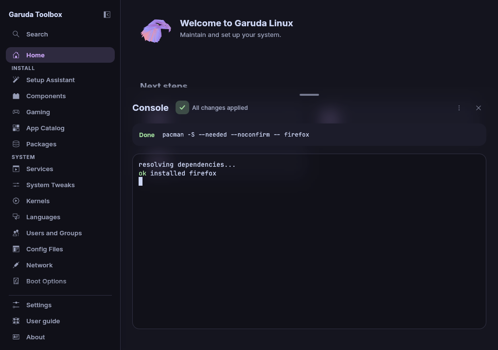

# The Console

The **Console** shows the programs the app runs, as a full terminal. You can
type into it, so programs that ask a question or open an editor work there,
for example the diff review of AUR packages.

Open it with `Ctrl+j` or with **Toggle console** in the command palette. The
app also opens it when you apply changes or run an operation with **Run
now**.

While nothing has run yet, the terminal says in grey that the output of
the next apply shows there. The line goes as soon as a program prints.
After a run that printed nothing, it says **The changes printed nothing.**

The Console slides up over the page and takes three quarters of its
height. The page keeps its size and stays usable above it, and you can
scroll every row of the page above the Console. Drag the bar at the
Console's top edge to make it taller or shorter. Drag it all the way down,
press `Esc` or click the close button to hide it. `Esc` stays with the
program while you type in the terminal. Behind the Console the page shows
blurred. After a finished run, opening another page hides the Console.

## See how an apply goes

While changes are applied, the line above the terminal says **Applying
changes…** and the step list marks the running step. Each step says
**Waiting**, **Running**, **Done**, **Nothing to do**, **Cancelled** or
**Failed** with its exit code.

## See how an apply ended

When the apply ends, the line above the terminal says how it went:

- **All changes applied**.
- **Applied, 2 steps had nothing to do** when some steps found their part
  already done, for example a file already as wanted or no orphans to
  remove. **Nothing needed to change** when no step had work.
- **Test mode: nothing was changed** in test mode, where no step runs.
  Every step then says **Not run (test mode)**.
- **Stopped before all changes were applied** when a step failed or the
  password was refused. Changes that did not run stay in the queue, so
  **Apply** runs them again.

When the update replaced the running kernel or system libraries,
[Home](home.md) offers **Restart…**.

### When the helper fails

The helper is the part of the app that runs the steps that need root. When
it fails, a red message in the Console says what failed, with the reason
the system gave:

| Message                                              | What happened                                                                                    |
| ---------------------------------------------------- | ------------------------------------------------------------------------------------------------ |
| **A password is missing for step …**                 | The step needs a password, such as a new user's, and came without one. The helper did not start. |
| **The helper could not be started: …**               | The system did not start the helper, for example because `pkexec` is missing.                    |
| **pkexec cannot run the helper: …**                  | `pkexec` itself is broken on this system, for example not set up as a root program.              |
| **The helper started without its input and output.** | The helper started, but the app could not talk to it.                                            |
| **The helper could not be followed: …**              | The app lost track of the helper while it ran.                                                   |
| **The helper ended before the changes were done: …** | The helper ended early, for example because it was killed.                                       |
| **The steps run in the app stopped unexpectedly: …** | The steps that run with your account, such as AUR updates with `paru`, stopped.                  |

What to do: read the reason in the message, then apply again. When it
fails again, see [A step failed](troubleshooting.md#a-step-failed) and
share the output on the
[issue tracker](https://gitlab.com/garuda-linux/applications/toolbox/-/issues).

## Answer a program

Click the terminal, then type. Every key goes to the running program,
including `Tab`. To leave the terminal with the keyboard, press `Ctrl+Tab` to
move forward, or `Ctrl+Shift+Tab` to move back. A hint under the terminal
says so while it has the focus.

## Stop a running program

Click **Cancel** beside the status line of the Console. It shows only
while something runs. The running step stops and the steps after it do not
run.

> **Warning:** Stopping a package update in the middle can leave the
> system half updated. Run the update again afterwards.

## Read, copy or clear the output

Once changes ran, the Console's header has a **⋯** button (**Console output
actions** for screen readers). Its menu holds:

- **Copy output** copies everything the programs printed, as plain text.
  A short note at the top right confirms it.
- **Share output…** uploads it, see below.
- **Clear output** empties the terminal and the step list, and the Console
  says **No changes are being applied** again. It also hides the link of an
  earlier upload.

Copy and Share are greyed out while no program printed anything, as after
a test run. Clear is greyed out while changes are applied, because the
running program still draws in the terminal.

Links that a program prints cannot be clicked, and nothing a program prints
opens your browser. Select the address and copy it.

## Share the output

To show the output to someone who helps you, upload it:

1. Open the **⋯** menu and click **Share output…**.
2. The dialog shows the exact text that will be sent. Read it and check it
   for anything you do not want to share. A program that writes on
   meanwhile does not change it.
3. Click **Upload**. One row in the Console says **Uploaded.**, with
   **Copy link** and **Hide**. Its **⋯** menu holds **Open in browser**,
   **Copy delete link** and **Delete now…**.

The upload works like the one on [Diagnostics](diagnostics.md#share-a-report):
the text goes to `bin.garudalinux.org`, encrypted on your computer, and
the server deletes it after one year. Nothing is sent before you click
**Upload**. **Cancel** sends nothing. With **Copy reports to the
clipboard** on in Settings, the link goes to the clipboard by itself.

> **Note:** Anyone who has the link can read the output. Programs print
> names, paths and package lists, so read the text before you upload it.

When the upload fails, a red message in the Console says why, with the same
words as on [Diagnostics](diagnostics.md#when-the-upload-fails). Check your
internet connection and share again.

## See also

- [Review and apply changes](applying.md)
- [Maintenance](maintenance.md)
- [Diagnostics](diagnostics.md)
