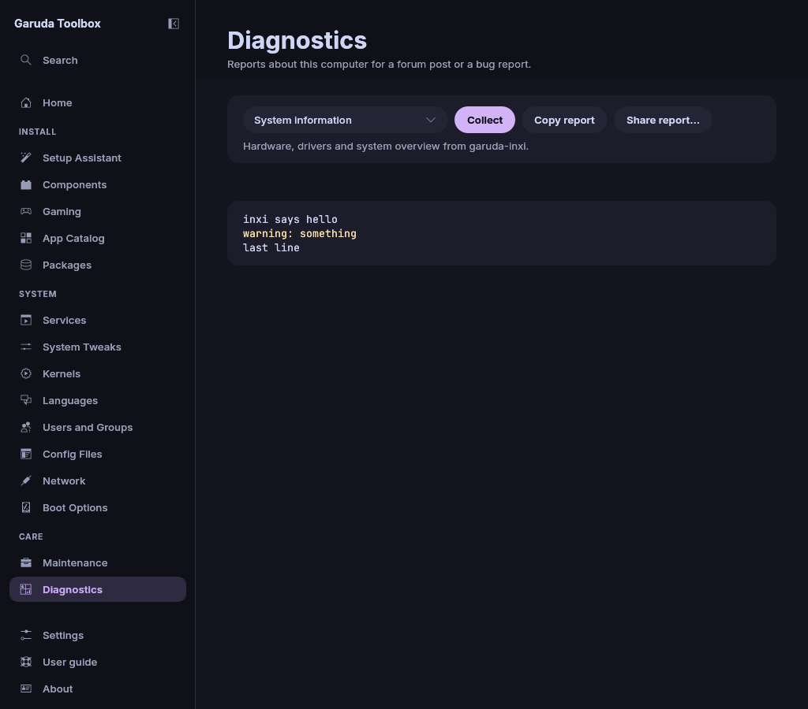
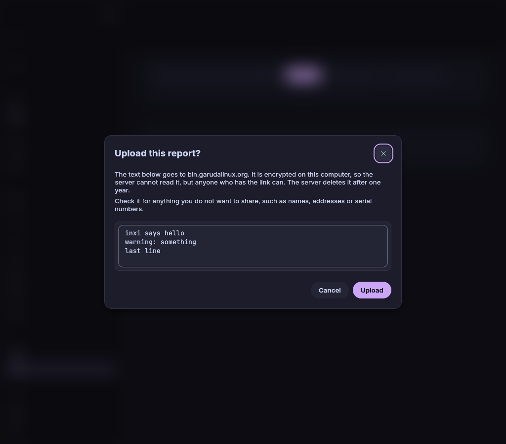

# Diagnostics

**Diagnostics** collects what people who help in the forum usually ask for:
system information, logs and health checks. The page shows them with the
colours the programs use in a terminal, and you copy or upload them as plain
text. Open it with **Diagnostics** in the sidebar.

Collecting a report changes nothing on your system, and nothing leaves your
computer unless you upload a report yourself.



## Collect a report

Choose a report in the list at the top and click **Collect**. The line
under the list says what the report holds. The report appears below, and
the page says what is being collected meanwhile. A long report scrolls in
its own box, which fills the window, so the buttons above it stay in view.
Long lines scroll sideways, as in a terminal.

| Report                 | What it collects                                                                        | Program                                                                      |
| ---------------------- | --------------------------------------------------------------------------------------- | ---------------------------------------------------------------------------- |
| **System information** | Hardware, drivers and a system overview                                                 | `garuda-inxi`                                                                |
| **System health**      | What is wrong with the system                                                           | `garuda-health --forcetty`                                                   |
| **Boot time**          | How long each service took to start and what the boot waited for                        | `systemd-analyze blame`, then `systemd-analyze critical-chain`               |
| **Journal**            | The last 1000 lines of the system journal                                               | `journalctl -e --no-pager`                                                   |
| **pacman log**         | What pacman logged since it last ran                                                    | The end of `/var/log/pacman.log`, from the last `Running 'pacman …'` line on |
| **Kernel log**         | The kernel's messages                                                                   | `dmesg --color=always`                                                       |
| **Full report**        | All of the above in one report, each part between `### name ###` and `### END name ###` | All of them, one after the other                                             |

Things to know:

- The report shows the colours a program uses in a terminal, for example red
  for failed units and errors in the journal, in the colours of your desktop
  theme. `garuda-inxi` and pacman's log have none. What you copy or upload
  is always plain text without colours.
- Starting another collector cancels the one that runs. **Cancel** beside
  **Collect**, shown while a collector runs, stops it without starting a new
  one. A **Full report** says which part it is at, for example **Collecting
  Journal (3 of 6)…**.
- A report is at most 2 MiB per collector. Of a longer output only the end
  is kept, and the first line of the report says so.
- Reports are in English, whatever language the app uses, so people who help
  can read them.
- A program that ends with an error but printed something still gives a
  report. Its error text and `Exit code:` follow at the end. `garuda-health`
  does this whenever it finds a problem.

### When you are asked for your password

**Journal** and **Kernel log** hold messages of the whole system. The app
reads them with your own rights when it can:

- The journal, when your account may open the system journal. Members of the
  groups `wheel`, `adm` and `systemd-journal` may.
- The kernel log, when `kernel.dmesg_restrict` is `0`. Arch based systems set
  it to `1`.

Otherwise the app's helper reads them as root and you are asked for your
password. The helper runs exactly `dmesg --color=always` or
`journalctl -e --no-pager` and nothing else. **Full report** can ask twice,
once for each of the two.

### When a collector gives no report

| The page says, for example                                                     | Why                                                                                         |
| ------------------------------------------------------------------------------ | ------------------------------------------------------------------------------------------- |
| `System information is not available on this system.`                          | The program is not installed. `garuda-inxi` and `garuda-health` exist on Garuda Linux only. |
| `Kernel log was not collected: the password dialog was closed.`                | You dismissed the password dialog.                                                          |
| `Kernel log was not collected: your account may not read this.`                | Your account may not get root rights.                                                       |
| `Kernel log was not collected: no password dialog could appear, …`             | Your desktop session runs no polkit authentication agent.                                   |
| `Kernel log was not collected: the helper of Garuda Toolbox is not installed.` | Reinstall Garuda Toolbox.                                                                   |
| `Kernel log failed:` and the program's words                                   | The program ended with an error and printed nothing.                                        |
| `pacman log printed nothing.`                                                  | The program ran and had nothing to say.                                                     |

In a **Full report** the part of such a collector holds one line that says
the same, and the other parts are still collected.

## Copy a report

Click **Copy report** beside **Collect**. **Copy report** and **Share
report…** show once a report is there. A short note at the top right of the
window confirms the copy. The copy is plain text without colours, ready to
paste into a forum post.

To copy every finished report without a click, switch on **Copy reports to
the clipboard** in [Settings](settings.md). The link of an uploaded report is
then copied too. Its delete link is never copied by itself.

> **Note:** On some Wayland desktops a window can only write to the clipboard
> while it has the focus, and the app cannot tell when a copy did not arrive.
> When a report finished while you were in another window and nothing pastes,
> click **Copy report** again.

## Share a report

Sharing uploads the report to Garuda's PrivateBin at `bin.garudalinux.org`
and gives you a link to post in the forum.

1. Collect a report.
2. Click **Share report…**.
3. Read the text in the **Upload this report?** dialog. It is exactly what
   will be uploaded: plain text without colours, with the values that name
   you or this computer replaced (see below). The dialog says how many were
   replaced. Type in **Search the text** to mark every match, for example
   of a name, and **Next match** to jump to the next one.
4. Click **Upload**. **Cancel** uploads nothing.



When the upload is done, the link appears above the report, with its
buttons under it. **Copy link** copies it, **Open in browser** opens the
paste, **Hide** removes the link.

> **Warning:** Anyone who has the whole link can read the report. The report
> is encrypted on your computer before it is sent. The key is the part of the
> link after `#`, which the server never sees, so the server cannot read the
> report. The server deletes it after one month. To remove it earlier, see
> below.

### What the upload replaces

Before the dialog opens, the Toolbox replaces these values in the text it
uploads. The report on the page and **Copy report** keep them.

| Value                                                  | Placeholder                   |
| ------------------------------------------------------ | ----------------------------- |
| Your user name, as a whole word                        | `<user>`                      |
| Your home folder                                       | `<home>`                      |
| The computer's host name, as a whole word              | `<host>`                      |
| Serial numbers of the computer that your user can read | `<serial-1>`, `<serial-2>`, … |
| UUIDs of disks and partitions                          | `<uuid-1>`, …                 |
| Hardware (MAC) addresses                               | `<mac-1>`, …                  |
| Public and link-local IP addresses                     | `<ip-1>`, …                   |

One value keeps its number through the whole text, so a helper still sees
that two lines name the same disk. Private addresses such as
`192.168.1.10`, loopback and documentation addresses stay.

> **Note:** The replacement finds only what it knows or what has a fixed
> shape. A name in a file path of another user, an email address or a
> Wi-Fi network name stays. Search the text for them before you upload.

### Delete an uploaded report

Under the link the page shows a second one, labelled **Delete link: opening
it removes the report from the server.**

- **Delete now…** asks **Delete the report from the server?** first.
  **Delete** then opens the delete link in your browser. The server removes
  the report at once, and the link to the report stops working for everyone.
- **Copy delete link** copies it, so you can keep it and delete the report
  later, for example when your forum topic is solved.

The delete link cannot be used to read the report, but anyone who has it can
delete the report. Keep it to yourself and post only the first link. The app
does not store either link: **Hide**, the next upload or closing the app
forgets both, and a report whose delete link is lost stays on the server
until it expires.

### When the upload fails

When the upload fails, a red message above the report says why, with what
the network or the server said in brackets. The report stays on the page,
so you can try again with **Share report…** or copy it. **Dismiss** hides
the message.

| Message                                                                                                   | What to do                                                                                                                                                   |
| --------------------------------------------------------------------------------------------------------- | ------------------------------------------------------------------------------------------------------------------------------------------------------------ |
| **The upload failed. bin.garudalinux.org could not be reached. Check the network connection.**            | Check that you are online, then try again. A firewall or proxy can also block the server.                                                                    |
| **The upload failed. The paste service refused the report, for example because it is too large.**         | Collect a single collector instead of **Full report**, or copy the report and share only part.                                                               |
| **The upload failed. The paste service sent an answer the Toolbox does not understand.**                  | Try again later. The server may be under maintenance.                                                                                                        |
| **The upload failed. The report could not be encrypted.**                                                 | Try again. Without encryption the app sends nothing.                                                                                                         |
| **The upload failed because of an error in Garuda Toolbox. Report it on the forum or the issue tracker.** | The upload stopped inside the app. Try again, and see [A button does nothing or the app closed](troubleshooting.md#a-button-does-nothing-or-the-app-closed). |

## Start a collector from a command

To open the page and start a collector at once, for example from a script or
a desktop shortcut:

```console
$ garuda-toolbox --page diagnostics --action inxi
```

`--action` takes `inxi`, `garuda-health`, `systemd-analyze`, `journalctl`,
`pacman`, `dmesg` or `all`. When the app is already running, its window asks
to come to the front and opens the page. It runs the collector only when the window
was already in front, because a collector may ask for a password. Otherwise
click the collector's button. An upload never starts this way.

To get a report in the terminal instead, without the window, use
`garuda-toolbox diagnostics inxi`. See [The command line](cli.md).

## See also

- [Settings and About](settings.md)
- [Home and system status](home.md)
- [Maintenance](maintenance.md)
- [The command line](cli.md)
