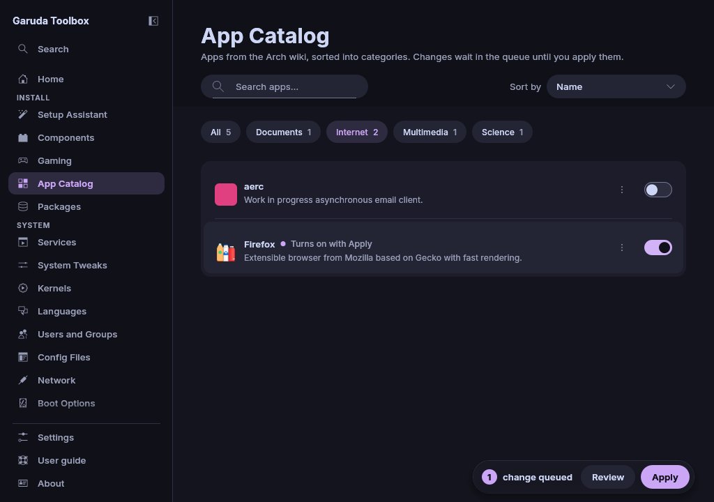

# App Catalog

**App Catalog** finds and installs apps from the Arch wiki's application
lists: office programs, games, browsers and mail clients, media players,
science tools, security tools and utilities.

## Browse a category

The chips above the list pick what it shows. **All** (at first) lists the
apps of every category. A chip such as **Internet** or **Multimedia** shows
that category alone. The number on each chip counts the apps your system
can install.

Every row shows the app's icon, its name and a short description, with a
switch at the right. A switch that is on means the app's package is
installed.

## Search

To find an app, type in **Search apps…** at the top. The search looks at
the names, descriptions and package names of the apps the chosen chip
shows. With **All** it looks through every category, and each result names
its category, for example **Internet** next to Firefox. While you search,
the number on each chip counts its matches, and a chip still picks its
category. Clear the field to see the whole category again.

When nothing matches, the page says so, quotes your search text and
explains what the search looks at.

## Sort the list

**Sort by** at the right of the search field orders the apps of a category
or of a search.

| Choice             | Order                                                                    |
| ------------------ | ------------------------------------------------------------------------ |
| **Name**           | By name, upper and lower case mixed. This is how the page opens          |
| **Selected first** | Installed apps and apps queued for installation on top, the rest by name |

With **Selected first** an app moves to the top as soon as you queue it, and
back down when you queue its removal.

## Install or remove an app

1. Turn the row's switch on or off, or click the row. Nothing changes yet:
   the row says **Turns on with Apply** or **Turns off with Apply**.
2. Flip it back to take the change out of the queue.
3. Apply the queue, see [Review and apply changes](applying.md).

When it worked, the switches follow the installed packages and the queue is
empty.

> **Note:** Removing an app also removes the dependencies nothing else
> needs. Turn the switch on again and apply to install it back.

## Open an app's website

The **⋯** button of a row (**More for** and the app's name) holds **Open
website**, which opens the site in your web browser. With the keyboard,
select the row and press the `Menu` key. Only `https` sites from the app's
list are opened.

## Use the keyboard

| Key              | What it does                                                   |
| ---------------- | -------------------------------------------------------------- |
| `Tab`            | Moves between the search, the chips, the sort box and the list |
| `Up` and `Down`  | Move through the list                                          |
| `Space`, `Enter` | Queues or takes back the selected app                          |
| `Menu`           | Opens the selected app's menu                                  |

## Why some apps are missing

The page only shows apps your system can install: packages the
repositories in `/etc/pacman.conf` offer, plus anything already installed,
so you can still remove it. Categories without such apps are hidden.

- Some apps come from the Chaotic-AUR repository that Garuda Linux
  enables, for example `brave-bin`. On other Arch based systems without it
  they are hidden.
- The list comes from the package databases as pacman last downloaded
  them. After you add a repository, update the system once (see
  [Maintenance](maintenance.md)) to see its apps here.
- When several apps of the wiki lists install the same package (the
  LibreOffice programs all come from one package), the list keeps one row
  for it.
- On a system without pacman databases the app cannot tell, so every app
  shows. When the installed packages cannot be read, a message above the
  list says so: no switch then shows what is installed, and switching on
  an app that is installed changes nothing.

## Where the icons come from

A row shows the icon your icon theme has for the package. When the theme
has none, it shows the picture from the AppStream data of the repositories
(the `archlinux-appstream-data` package), and otherwise a generic package
icon.

## See also

- [Gaming](gaming.md)
- [Components](components.md)
- [Review and apply changes](applying.md)
- [Maintenance](maintenance.md)
- [The command line](cli.md)
