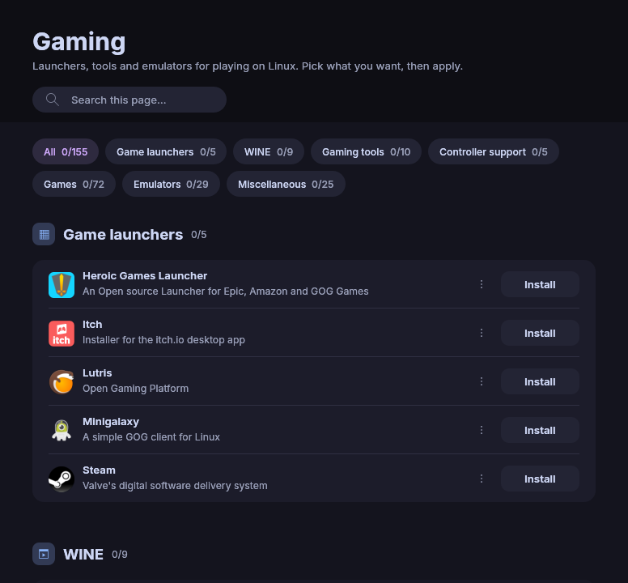

# Gaming

**Gaming** installs game launchers, WINE and Proton tools, performance
tools, controller drivers, games and emulators.

## Find an entry

Type in **Search this page…** above the rows. Only the rows whose name or
description holds the text stay. **Nothing matches the search** with
**Clear search** appears when none does.

## Install or remove a gaming app

Each row is one package, for example `steam`, `lutris` or `retroarch`. An
installed one says **Installed**.

1. Click **Install** or **Remove** on the row, or press `Space` on it.
   Nothing changes yet: the row says **Installs with Apply** or **Removes
   with Apply**.
2. Click **Take back** to take the change out of the queue.
3. Apply the queue, see [Review and apply changes](applying.md).

## Rows that install more than one package

Some tools need their 32-bit library for 32-bit games. **Gamemode** also
installs `lib32-gamemode`, and **MangoHud** also installs
`lib32-mangohud`. **Remove** removes both packages. The row follows the
main package alone.

A `-git` build of a package counts as installed, and **Remove** removes
that build. Some rows name a `-git` package themselves, for example
`luxtorpeda-git`.

## Open a game's website

Many games, such as **0 A.D.**, have **Open website** in the **⋯** menu of
their row (**Actions for** and the game's name). It opens the game's site
in your web browser without changing the queue. With the keyboard, select
the row and press the `Menu` key. Only `https` sites from the app's own
list are opened.

## Why some apps are missing

See [Why some apps are missing](discover.md#why-some-apps-are-missing) on
App Catalog. The same rules apply here.

## See also

- [Components](components.md)
- [Review and apply changes](applying.md)
- [The Console](console.md)
- [The command line](cli.md)
