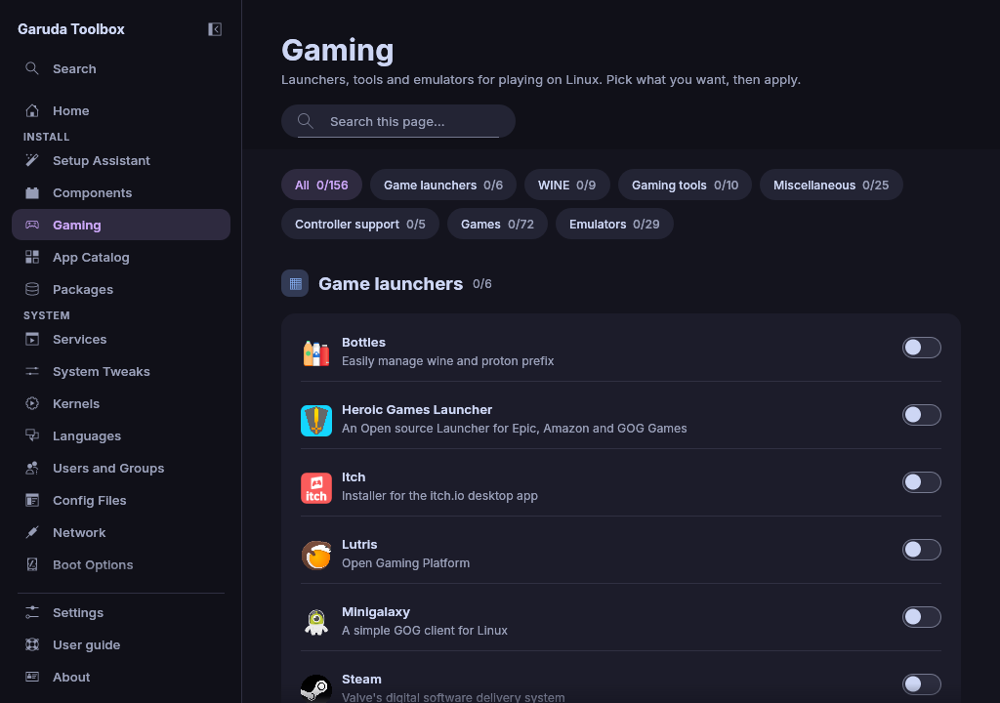

# Gaming

**Gaming** installs game launchers, WINE and Proton tools, performance
tools, controller drivers, games and emulators.

## Find an entry

Type in **Search this page…** above the rows. Only the rows whose name or
description holds the text stay. **Nothing matches the search** with
**Clear search** appears when none does.

## Install or remove a gaming app

Each row is one package, for example `steam`, `lutris` or `retroarch`. A
switch that is on means it is installed.

1. Turn the row's switch on or off, or click the row, or press `Space` on it.
   Nothing changes yet: the row says **Turns on with Apply** or **Turns off
   with Apply**.
2. Flip it back to take the change out of the queue.
3. Apply the queue, see [Review and apply changes](applying.md).

## Rows that install more than one package

Some tools need their 32-bit library for 32-bit games. **Gamemode** also
installs `lib32-gamemode`, and **MangoHud** also installs
`lib32-mangohud`. Turning the row off removes both packages. The switch
follows the main package alone.

A `-git` build of a package counts as installed, and turning the row off
removes that build. Some rows name a `-git` package themselves, for example
`luxtorpeda-git`.

## Open a game's website

Many games, such as **0 A.D.**, have a button with a browser icon on their
row. Its tooltip reads "Website of" and the game's name. It opens the
game's site in your web browser without changing the queue. Only `https`
sites from the app's own list are opened.

## Why some apps are missing

See [Why some apps are missing](discover.md#why-some-apps-are-missing) on
App Catalog. The same rules apply here.

## See also

- [Components](components.md)
- [Review and apply changes](applying.md)
- [The Console](console.md)
- [The command line](cli.md)
