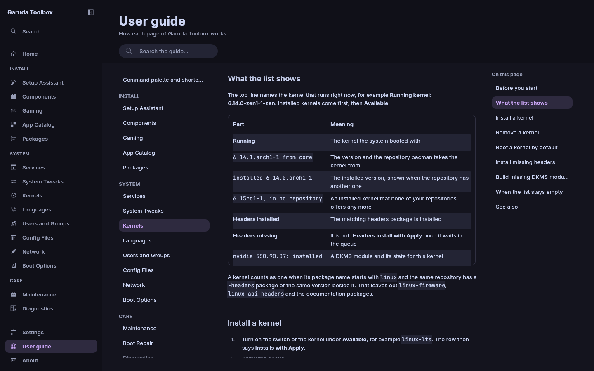

# User guide

**User guide** shows this guide inside the app. Open it at the bottom of
the sidebar, between **Settings** and **About**, or press `F1` on any page
to open the guide page about it.

The guide is built into the app, so it always matches the version you run.

## Read a page

The page shows three parts:

| Part                   | What it holds                                                                                        |
| ---------------------- | ---------------------------------------------------------------------------------------------------- |
| The list at the left   | Every page of the guide under its part: **Basics**, **Install**, **System**, **Care**, **Reference** |
| The page in the middle | The open page, with its part and title at the top                                                    |
| **On this page**       | The headings of the open page, the one you read marked. It shows in a wide window only               |

1. Click a page in the list at the left.
2. Click a heading under **On this page** to go to it.

A link in the text opens the guide page it names, or the web page in your
browser. At the end of each page, the links with arrows open the page
before and after it.

## Open the page the guide explains

Guide pages about a page of the app have an **Open** button at the top
right, for example **Open Kernels**. Click it to go to that page.

## Search the guide

1. Type into **Search the guide…** at the top. The middle part then lists
   every place that holds all the words you typed, page titles first, then
   headings, then the text. Upper and lower case do not matter.
2. Click a place to open its page at that heading.

When nothing matches, the page says **Nothing in the guide matches** and
the words you typed. Empty the search to see the open page again.

## Help for the open page

Press `F1` on any page, or pick **Help for this page** in the
[command palette](command-palette.md). The guide opens on the page about
the page you were on. **Settings** and **About** share one guide page.

## Read the guide on the command line

`garuda-toolbox guide list` lists the pages, and
`garuda-toolbox guide show kernels` prints one, see
[The command line](cli.md#reading).

## See also

- [Command palette and shortcuts](command-palette.md)
- [Settings and About](settings.md)
- [The command line](cli.md)
