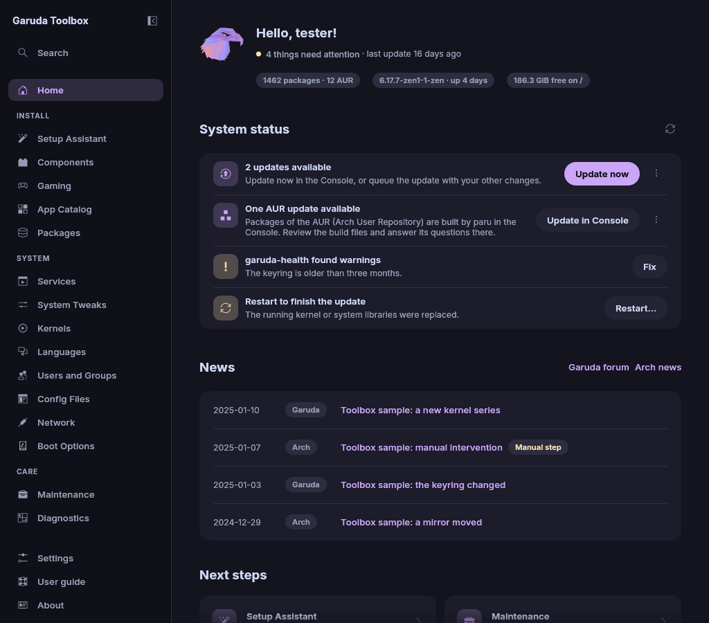

# Home and system status

**Home** opens first. Under the greeting a line says how many things need
your attention, or **Everything is fine**, and when the last update ran.

Below it, three labels name facts about the system:

- the installed packages, with how many come from the AUR. Click it to
  open [Packages](packages.md).
- the running kernel and how long the system has been up.
- the free space on `/`. It turns yellow when the space is low.

**System status** lists only what needs your attention. When nothing
does, a card says how many checks passed and names them.

## Status cards

Each card has one button at its right. A card with more to offer has a
**⋯** button beside it that opens the rest. In a narrow window they sit
under its text.

| Card                                                                 | Shown when                                                                         | Buttons                                                         |
| -------------------------------------------------------------------- | ---------------------------------------------------------------------------------- | --------------------------------------------------------------- |
| **2 updates available**                                              | The repositories have newer packages (`checkupdates`)                              | **Update now**, in **⋯** **Queue update** and **Show packages** |
| **One AUR update available**                                         | AUR packages have newer versions (`paru -Qua`)                                     | **Update in Console**, in **⋯** **Show packages**               |
| **The last update is overdue**                                       | The last update is more than 14 days old, no updates known                         | **Update now**                                                  |
| **Configuration files to merge**                                     | `.pacnew` or `.pacsave` files wait (`pacdiff -o`)                                  | none, the merge tool opens from [Maintenance](maintenance.md)   |
| **Disk space is low**                                                | Less than a tenth of `/` is free, or less than 10 GB                               | **Open Maintenance**                                            |
| **A service failed**                                                 | A system service stopped with an error, named in the card                          | **Show in Services**                                            |
| **Orphans and package cache**                                        | A package is no longer needed, or the cache holds over 5 GB                        | **Queue clean-up**, then **Don't clean up** to take it back     |
| **garuda-health found warnings** or **garuda-health found problems** | `garuda-health` reports LOW issues (warnings), or HIGH or CRITICAL ones (problems) | **Fix**, or **Show in Console** when it cannot fix them         |
| **Restart to finish the update**                                     | The running kernel or system libraries were replaced                               | **Restart…** asks first, then restarts                          |

On a disk of 100 GB or less the limit is a tenth of it, and on a bigger
disk it is 10 GB. **Queue clean-up** queues removing the orphans and
cleaning the package cache, as [Maintenance](maintenance.md) does. Both
run with your other changes after you review them.

The restart goes through the system's login service. It may ask for a
password, for example when other users are logged in.

## See which packages will be updated

Open the **⋯** menu of either update card and click **Show packages**.
**Pending updates** lists every package with the installed and the new
version, for example
`linux-zen` with `6.13.8.zen1-1 → 6.14.1.zen1-1`. Repository packages come
first. Packages from the AUR follow and are marked **AUR**.

The list is as fresh as the last check. Click **Read again** beside
**System status** to renew it.

## Update AUR packages

Packages of the AUR (Arch User Repository) are built from scripts its
users share, not taken from Garuda Linux's repositories.

**Update in Console** runs `paru -Sua` in the Console's terminal. paru
shows the build files and asks its questions there, so you can review the
changes and answer, also in an editor paru opens.

## When a check fails

A message says how many checks could not run, and the card of passed
checks does not show. **Show details** names each check with the reason
the system gave, and **Read again** runs the checks once more. When the
update check failed, for example without a network, one message reads
**The update check failed.** with **Read again**.

## When the status is checked

- When the app starts.
- After every apply, successful or not.
- With **Read again** beside **System status**, or `F5`.
- Every hour while the app runs. Change this under **Settings** →
  **Check for updates**, or turn it off with **Only when I ask**.

Each check downloads the package lists into a temporary folder and asks
the AUR, so it needs the network. It never changes the installed system.

The facts under the greeting, the disk, the services and the clean-up are
read again at the same times, and also when [Packages](packages.md)
reads its list again.

## News

**News** lists the four newest posts of Garuda Linux's forum
announcements and Arch Linux's news in one list, newest first. Each post
has its day and its source, **Garuda** or **Arch**. A post that asks you
to do something by hand around an update is marked **Manual step**: on
Arch the posts whose title says "manual intervention", on Garuda the
posts of the forum's Maintenance announcements.

Click a title to open the post in your browser. **Garuda forum** and
**Arch news** beside the heading open all posts of each site. The app asks
each site at most every six hours and keeps its posts, so they show
without a network too.

## Next steps

Below the news, **Next steps** offers up to three cards: **Review
changes** while changes wait, **Setup Assistant** until you have gone
through it once (not on a live system), then **Maintenance** and
**Diagnostics**.
Every other page is in the sidebar. The links to Garuda Linux's websites
and community are on **About**.

**Recently used** shows the last three pages you opened. Click one to go
back to it.

## Notifications

When an apply finishes while the window is not in front, a desktop
notification says whether it worked.

## On the live ISO

Started from the live ISO, Home shows **Live system** instead of the
status:

- **Install Garuda Linux** → **Start installer** opens the installer. It
  asks for your password. When the installer cannot start, a red note
  above the cards says **The installer could not start:** with the reason.
- When the live system's tools could not be looked for, a message says
  so above the cards. **Read again** looks once more.
- **Repair an installed system** → **Open in Console** asks for your
  password and opens a root shell inside the Garuda Linux installed on
  this computer, in the Console. Repair what you need there, for example
  reinstall a package or update GRUB. Type `exit` to leave it.

The sidebar of the live ISO also has **Boot Repair**, which installs GRUB
again or writes the boot menu again without a shell. See
[Boot Repair](boot-repair.md).
