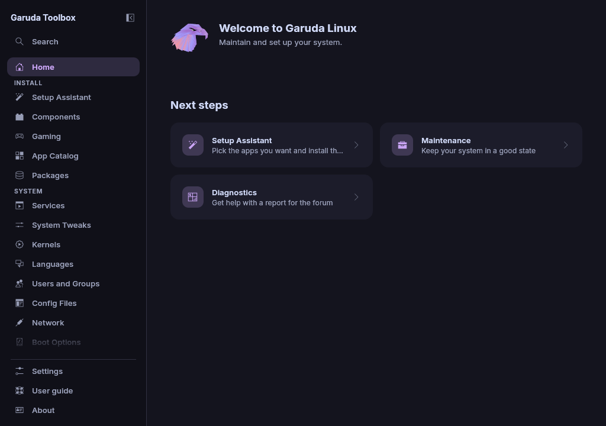

# Home and system status

**Home** opens first. Under the greeting a line says how many things need
your attention, or **Everything is fine**, and when the last update ran.

Below it, four tiles show the system's figures. Each has a mark: a green
tick while the figure is fine, a yellow warning when it needs a look, and
a grey mark while it is not read yet or its check could not run (the tile
then says **Not known**).

| Tile            | Shows                                                                             | Needs a look when               | Opens                         |
| --------------- | --------------------------------------------------------------------------------- | ------------------------------- | ----------------------------- |
| **Updates**     | **Up to date**, or how many updates of the repositories and the AUR are available | Any update is available         | **Maintenance** → **Common**  |
| **Disk**        | The free space on `/`                                                             | The space is low, see below     | **Maintenance** → **Common**  |
| **Health**      | **No problems**, **Warnings** or **Problems found** of `garuda-health`            | `garuda-health` found something | **Maintenance** → **Repairs** |
| **Last update** | **Today**, **Yesterday** or how many days ago                                     | It is more than 14 days ago     | **Maintenance** → **Common**  |

Click a tile, or focus it with `Tab` and press `Enter` or `Space`, to open
the tab that acts on it.

**System Status** lists only what needs your attention. When nothing
does, a card says how many checks passed and names them.

## Status cards

Each card has one button at its right. A card with more to offer has a **⋯**
button beside it that opens the rest. In a narrow window they sit under its
text.

| Card                                                                 | Shown when                                                                         | Buttons                                                         |
| -------------------------------------------------------------------- | ---------------------------------------------------------------------------------- | --------------------------------------------------------------- |
| **2 updates available**                                              | The repositories have newer packages (`checkupdates`)                              | **Update Now**, in **⋯** **Queue Update** and **Show Packages** |
| **One AUR update available**                                         | AUR packages have newer versions (`paru -Qua`)                                     | **Update in Console**, in **⋯** **Show Packages**               |
| **The last update is overdue**                                       | The last update is more than 14 days old, no updates known                         | **Update Now**                                                  |
| **Configuration Files to Merge**                                     | `.pacnew` or `.pacsave` files wait (`pacdiff -o`)                                  | **Review…**, in **⋯** **Open in meld**                          |
| **Disk space is low**                                                | Less than a tenth of `/` is free, or less than 10 GB                               | **Open Maintenance**                                            |
| **A service failed**                                                 | A system service stopped with an error, named in the card                          | **Show in Services**                                            |
| **Orphans and Package Cache**                                        | A package is no longer needed, or the cache holds over 5 GB                        | **Queue Clean-up**, then **Don't Clean Up** to take it back     |
| **garuda-health found warnings** or **garuda-health found problems** | `garuda-health` reports LOW issues (warnings), or HIGH or CRITICAL ones (problems) | **Fix**, or **Show in Console** when it cannot fix them         |
| **Restart to finish the update**                                     | The running kernel or system libraries were replaced                               | **Restart…** asks first, then restarts                          |

On a disk of 100 GB or less the limit is a tenth of it, and on a bigger
disk it is 10 GB. **Queue Clean-up** queues removing the orphans and
cleaning the package cache, as [Maintenance](maintenance.md) does. Both
run with your other changes after you review them.

The restart goes through the system's login service. It may ask for a
password, for example when other users are logged in.

## Merge configuration files

When an update brings a new version of a configuration file you edited,
pacman keeps your file and saves the new one beside it as `.pacnew`. When
it removes or replaces a file you edited, it keeps your version as
`.pacsave`. Home lists these copies under **Configuration files to
merge**.

1. Click **Review…**.
1. For each change, pick **Keep Current** or **Take New** (**Take Saved**
   for a `.pacsave`). Every change starts at **Keep Current**.
1. Click **Queue the Merge**. To queue the whole file instead, click
   **Keep Current File** or **Use New File** (**Restore Saved File** for a
   `.pacsave`). To change the merged text by hand, click **Edit Result…**.
1. Apply your changes.

A queued file shows **queued** in the list. **Take Back** removes it from
the queue.

| Copy                             | Actions                                                         |
| -------------------------------- | --------------------------------------------------------------- |
| Same as the file in use          | **Remove the Copy**                                             |
| File in use is gone              | **Use New File** or **Restore Saved File**, **Remove the Copy** |
| Older save (`.pacsave.1` and up) | **Remove the Copy**                                             |

Files only root may read, such as `/etc/sudoers`, ask for your password.
The dialog leaves out copies of files that hold secrets, such as
`/etc/shadow.pacnew`. Merge those in a terminal, or with **⋯** → **Open
in meld** on the card.

> **Note:** Where snapper is set up, the toolbox takes a snapshot of `/`
> first. It keeps the old file in `/var/lib/garuda-toolbox/backups`.

To merge from a terminal, see `garuda-toolbox merges` in
[Command line](cli.md).

## See which packages will be updated

Open the **⋯** menu of either update card and click **Show Packages**.
**Pending Updates** lists every package with the installed and the new
version, for example `linux-zen` with `6.13.8.zen1-1 → 6.14.1.zen1-1`.
Repository packages come first. Packages from the AUR follow and are
marked **AUR**.

The list is as fresh as the last check. Click **Read Again** beside
**System Status** to renew it.

## Update AUR packages

Packages of the AUR (Arch User Repository) are built from scripts its
users share, not taken from Garuda Linux's repositories.

**Update in Console** runs `paru -Sua` in the Console's terminal. paru
shows the build files and asks its questions there, so you can review the
changes and answer, also in an editor paru opens.

## When a check fails

A message says how many checks could not run, and the card of passed checks does
not show. **Show Details** names each check with the reason the system gave, and
**Read Again** runs the checks once more. When the update check failed, for
example without a network, one message reads **The update check failed.** with
**Read Again**.

## When the status is checked

- When the app starts.
- After every apply, successful or not.
- With **Read Again** beside **System Status**, or `F5`.
- Every hour while the app runs. Change this under **Settings** → **Time
  between checks**, or turn **Check for updates automatically** off.

Each check downloads the package lists into a temporary folder and asks
the AUR, so it needs the network. It never changes the installed system.

The tiles under the greeting, the disk, the services and the clean-up are
read again at the same times, and also when [Packages](packages.md)
reads its list again.

## News

**News** lists the four newest posts of Garuda Linux's forum
announcements and Arch Linux's news in one list, newest first. Each post
has its day and its source, **Garuda** or **Arch**. A post that asks you
to do something by hand around an update is marked **Manual step**: on
Arch the posts whose title says "manual intervention", on Garuda the
posts of the forum's Maintenance announcements.

Click a title to open the post in your browser. **Garuda forum** and **Arch
news** beside the heading open all posts of each site. The app asks each site at
most every six hours and keeps its posts, so they show without a network too.

## Next steps

Below the news, **Next Steps** offers up to three cards on one line. It
takes them in this order and shows the first three that apply:

1. **Review Changes**, while changes wait.
1. **Setup Assistant**, until you have gone through it once. A live system
   never shows it.
1. **Maintenance**.
1. **Diagnostics**.

With changes waiting and the Setup Assistant still to do,
**Diagnostics** is left out. With neither, only **Maintenance** and
**Diagnostics** show. In a narrow window the cards wrap onto more lines.
Every other page is in the sidebar. The links to Garuda Linux's websites
and community are on **About**.

**Recently Used** shows the last three pages you opened. Click one to go
back to it.

## Notifications

When an apply finishes while the window is not in front, a desktop
notification says whether it worked.

## On the live ISO

Started from the live ISO, Home shows **Live System** instead of the
status:

- **Install Garuda Linux** → **Start Installer** opens the installer. It
  asks for your password. When the installer cannot start, a red note
  above the cards says **The installer could not start:** with the reason.
- When the live system's tools could not be looked for, a message says
  so above the cards. **Read Again** looks once more.
- **Repair an Installed System** → **Open in Console** asks for your
  password and opens a root shell inside the Garuda Linux installed on
  this computer, in the Console. Repair what you need there, for example
  reinstall a package or update GRUB. Type `exit` to leave it.

The sidebar of the live ISO also has **Boot Repair**, which installs GRUB
again or writes the boot menu again without a shell. See
[Boot Repair](boot-repair.md).
