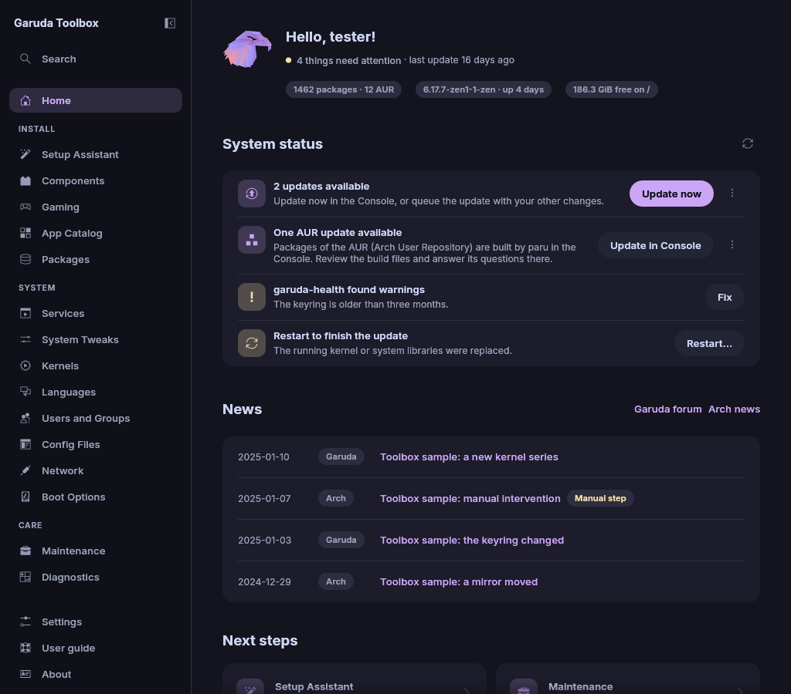

# Introduction

Garuda Toolbox keeps an Arch based system in good shape. It updates the
system, cleans up packages and runs Garuda's repair tools, all from one
window.

The app runs as you. When a change needs root rights, it asks for your
password once per apply through the usual password dialog of your desktop.

## Start the app

Open **Garuda Toolbox** from the application menu, or run `garuda-toolbox`.
A second start brings the open window to the front instead of opening a new
one. A minimized window opens again. Some desktops only let a window come
to the front when the start came from their own launcher. Otherwise the
window's taskbar entry asks for your attention instead.

To open a page directly, start the app with `--page` and the page's id, for
example `garuda-toolbox --page maintenance`. `garuda-toolbox pages` lists
every id.

## Find your way

The sidebar on the left lists the pages in three groups:

| Group       | Pages                                                                                              |
| ----------- | -------------------------------------------------------------------------------------------------- |
| **Install** | Setup Assistant, Components, Gaming, App Catalog                                                   |
| **System**  | Services, System Tweaks, Kernels, Languages, Users and Groups, Config Files, Network, Boot Options |
| **Care**    | Maintenance, Boot Repair, Diagnostics                                                              |

Home sits above the groups, Settings and About below them. Boot Repair
shows only on the Garuda live system. **Search** at the top of the sidebar
opens the [command palette](command-palette.md). The button beside the
app's name collapses the sidebar to its icons.

Changes you make wait in the queue. The changes pill at the bottom right
counts them, see [Review and apply changes](applying.md). The
[Console](console.md) shows what the programs print while changes are
applied.

The keys that work on every page are listed in
[Command palette and shortcuts](command-palette.md#keyboard-shortcuts).

## When a page cannot read the system

A page reads parts of the system when the app starts and after every apply:
installed packages, services, accounts, settings files. When one of them
cannot be read, the page says so in a message at the top, with **Read
again**. The page then shows that part as not known.
The status bar at the bottom of the window lists what could not be read,
for example **Some parts of the system could not be read: user services**.

A part the system does not have at all, such as GRUB on a machine with
another boot loader, is not an error. The page says **not available**
instead.

Click **Read again** once the cause is fixed.
[Troubleshooting](troubleshooting.md#something-could-not-be-read) explains
the common causes.

## See also

- [Review and apply changes](applying.md)
- [Maintenance](maintenance.md)
- [The command line](cli.md)
