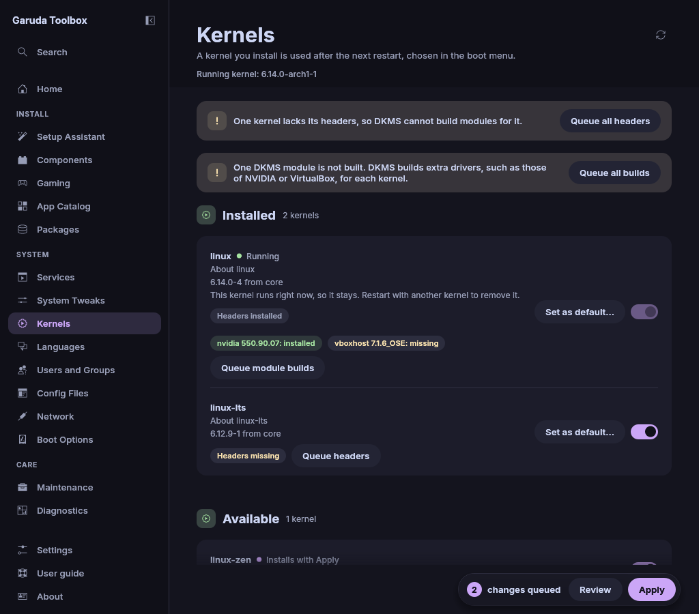

# Kernels

**Kernels** lists the Linux kernels your repositories offer and the ones you
have installed, with their headers and DKMS modules.

Changes wait in the queue until you apply them, see
[Review and apply changes](applying.md).

## Before you start

- The list comes from pacman's package databases, as fresh as your last
  update. Update the system on [Maintenance](maintenance.md) first to see the
  newest versions.
- A new kernel is used after a reboot. To boot it by default, see
  [Boot a kernel by default](#boot-a-kernel-by-default).

## What the list shows

The top line names the kernel that runs right now, for example **Running
kernel: 6.14.0-zen1-1-zen**. Installed kernels come first, then
**Available**.

| Part                          | Meaning                                                              |
| ----------------------------- | -------------------------------------------------------------------- |
| **Running**                   | The kernel the system booted with                                    |
| `6.14.1.arch1-1 from core`    | The version and the repository pacman takes the kernel from          |
| `installed 6.14.0.arch1-1`    | The installed version, shown when the repository has another one     |
| `6.15rc1-1, in no repository` | An installed kernel that none of your repositories offers any more   |
| **Headers installed**         | The matching headers package is installed                            |
| **Headers missing**           | It is not. **Headers install with Apply** once it waits in the queue |
| `nvidia 550.90.07: installed` | A DKMS module and its state for this kernel                          |

A kernel counts as one when its package name starts with `linux` and the same
repository has a `-headers` package of the same version beside it. That
leaves out `linux-firmware`, `linux-api-headers` and the documentation
packages.

## Install a kernel

1. Turn on the switch of the kernel under **Available**, for example
   `linux-lts`. The row then says **Installs with Apply**.
2. Apply the queue.

The kernel and its headers are installed together. Turn the switch off
again to take a queued kernel back.

## Remove a kernel

1. Turn off the switch of an installed kernel. The row then says
   **Removes with Apply**.
2. Apply the queue.

The headers go with the kernel. Turn the switch on again to take a queued
removal back.

> **Warning:** A system without a kernel does not boot. The switch of the
> kernel that runs right now is greyed out and says why. The app also
> refuses to remove the last installed kernel, and says so above the list.
> Kernels that are only queued for installation do not count: install the
> new kernel first, reboot into it, then remove the old one.
>
> When the app cannot tell which kernel runs, for example after a kernel
> update removed the running kernel's modules, it removes no kernel at all
> until you restart the computer.

## Boot a kernel by default

1. Click **Set as default…** on an installed kernel.
2. [Boot Options](boot-options.md) opens with a note that offers the boot
   menu entry of that kernel. Nothing is queued yet.
3. Click **Queue as default** there, then apply the queue. **Do not change**
   leaves the default entry as it was.

The button shows on installed kernels that are not queued for removal. When
the boot menu has no entry for the kernel, Boot Options says so and offers
nothing. This happens right after you install the kernel in another
program without generating the boot menu again. On systemd-boot the note
offers the kernel's image, and a kernel without an image yet gets no
offer. On a system with neither, Boot Options only says that GRUB is not the
boot loader.

## Install missing headers

DKMS modules such as the NVIDIA or VirtualBox drivers are built from source
for each kernel, and that needs the kernel's headers.

- Click **Queue headers** on a kernel that shows **Headers missing**, or
- click **Queue all headers** at the top to queue the headers of every
  installed kernel that lacks them.

Then apply the queue. **Don't install headers** takes the headers back.

## Build missing DKMS modules

The app asks `dkms status` which modules are built for which kernel. For every
installed kernel with headers, the card lists each module:

| State                  | Meaning                                        |
| ---------------------- | ---------------------------------------------- |
| `installed`            | Built and installed for this kernel            |
| `built, not installed` | Built, but the kernel does not load it yet     |
| `broken`               | dkms cannot use the module's source any more   |
| `missing`              | dkms knows the module, but not for this kernel |

1. Click **Queue module builds** on the kernel, or **Queue all builds** at
   the top for all kernels.
2. Apply the queue.

Each build runs `dkms install <module>/<version> -k <kernel>` and shows its
output in the [Console](console.md). Builds run after the packages of the same
apply, so headers queued together with a build are there in time.
**Don't build modules** takes the builds of a kernel back.

**Read again** (or `F5`) reads the kernels and asks dkms again, for example
after you installed a driver outside the app. The app also asks again after
every apply.

> **Note:** A broken module has usually lost its source folder.
> Reinstall the package that ships the module (for example `nvidia-dkms`),
> then build again.

## When the list stays empty

| Message                                                      | Meaning                                                                    |
| ------------------------------------------------------------ | -------------------------------------------------------------------------- |
| **Reading the kernels…**                                     | The first look at the system is not done yet                               |
| **Kernels are not available on this system**                 | pacman's package databases could not be read (not an Arch system)          |
| **No kernels found**                                         | The repositories offer no kernel. Update the package databases             |
| **dkms is not installed, so there are no modules to build.** | Nothing on this system uses DKMS                                           |
| **dkms could not list its modules.**                         | `dkms status` failed. Run it in a terminal to see why, then **Read again** |

## See also

- [Review and apply changes](applying.md)
- [Boot Options](boot-options.md)
- [Maintenance](maintenance.md)
- [The Console](console.md)
- [The command line](cli.md)
