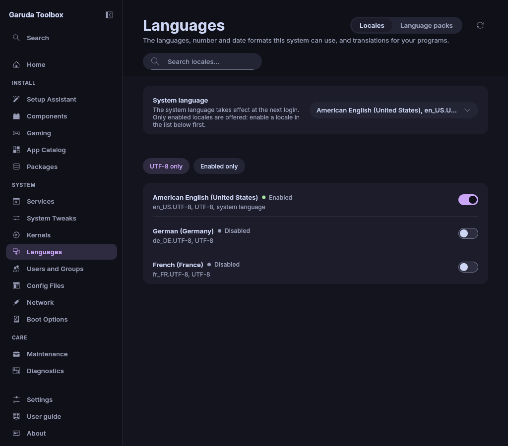

# Languages

**Languages** sets which languages and regional formats your system can use,
which one is the system language, and installs the language packs of your
programs.

A changed row shows **Changes with Apply**. Changes wait in the queue
until you apply them, see [Review and apply changes](applying.md).

A locale is a language together with a region and a character set, for example
`de_DE.UTF-8` for German as used in Germany. A program can only use a locale
that the system has generated.

## Find a locale

The **Locales** tab lists every locale the system can generate. Enabled ones
come first.

- Type in the search field to filter by language, country, locale or
  character set, for example `german`, `de_` or `ISO-8859`. Upper and lower
  case do not matter.
- **UTF-8 only** (on by default) hides the other character sets. Enabled locales
  show whatever their character set.
- **Enabled only** shows the enabled locales and the ones queued to be
  enabled.

Each row shows the language and the country of the locale in English, for
example `German (Germany)`, with the locale and its character set below it
(`de_DE.UTF-8, UTF-8`) and **Enabled** or **Disabled**. The row of the locale
your system language uses ends with `system language`.

The names come from the locale definitions that glibc installs below
`/usr/share/i18n/locales`. A locale without such a definition shows its code
alone. There are no flags: a flag stands for a country, and most languages
are spoken in more than one.

## Enable or disable a locale

1. Flip the row's switch (or select the row and press `Space`).
2. Apply the queue.

The app switches exactly that line in `/etc/locale.gen` and then runs
`locale-gen` once for all locale changes of the apply. Every other line of the
file stays as it is. A locale missing from the file is added at its end.

Two locales stay enabled, and the page says so above the list when you try:

- the locale of the system language (choose another system language first),
- the last enabled locale.

Taking back a locale also takes back the queued installs of its language
packs, unless another wanted locale uses the same pack.

## Choose the system language

1. Enable the locale you want, if it is not enabled yet. You do not need to
   apply first: a queued locale can be chosen right away.
2. Pick it under **System language**. Each choice names its language and
   region beside the code, for example `German (Germany), de_DE.UTF-8`. Only
   enabled locales are offered, as the line under the box says.
3. Apply the queue.

The app sets `LANG` in `/etc/locale.conf`, after the locales are generated.
Other lines of that file, such as `LC_TIME` for the date format, stay as they
are. The new language applies from your next login.

> **Note:** The app checks again while applying that `/etc/locale.gen` has the
> locale enabled, and leaves `/etc/locale.conf` alone otherwise. A system
> language without its locale makes programs fall back to English and print
> warnings.

## Install language packs

Some programs ship their translations, dictionaries or help in separate
packages, such as `firefox-i18n-de`, `libreoffice-fresh-de` or `hunspell-de`.
The **Language packs** tab lists the packs that fit your enabled locales
(queued ones included) and belong to a program you have installed.

- Flip a pack's switch (or select it and press `Space`) to queue its
  installation. Flip an installed pack's switch to queue its removal.
- **Queue all missing** queues every listed pack that is neither installed
  nor queued. The count beside it, **Missing**, counts exactly these.
- **Sort by** orders the packs by **Package** (the default), **Program** (the
  installed program a pack belongs to), **Language** or **Selected first**
  (installed and queued packs on top).

Each pack names its program and the language it is for, with the locale
beside it.

Then apply the queue.

A pack shows when its name is a program's name plus the language (`-de`) or
language and region (`-pt-br`, `-en_us`), with or without `-i18n`, `-l10n`,
`-help`, `-spell` or `-lang` in between, and that program is installed.

## When a list stays empty

The round arrow at the top right reads the lists again. An empty list
under a search offers **Clear search**.

| Message                                             | Meaning                                                         |
| --------------------------------------------------- | --------------------------------------------------------------- |
| **Reading the locales…**                            | The first look at the system is not done yet                    |
| **Locales are not available on this system**        | The system does not generate its locales from `/etc/locale.gen` |
| **No locale matches**                               | The search or the filters hide everything                       |
| **Language packs are not available on this system** | pacman's package databases could not be read                    |
| **No language packs found**                         | No installed program has a pack for an enabled locale           |

## See also

- [Review and apply changes](applying.md)
- [System Tweaks](system-settings.md)
- [Settings and About](settings.md)
- [The command line](cli.md)
