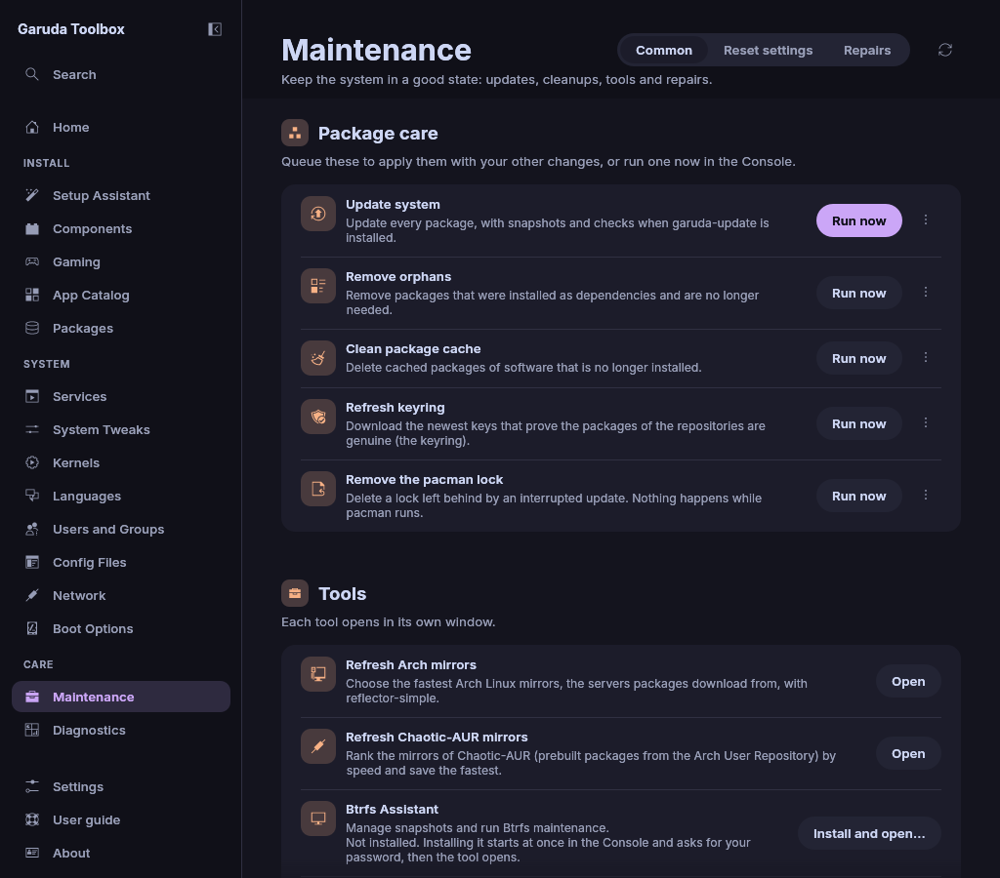
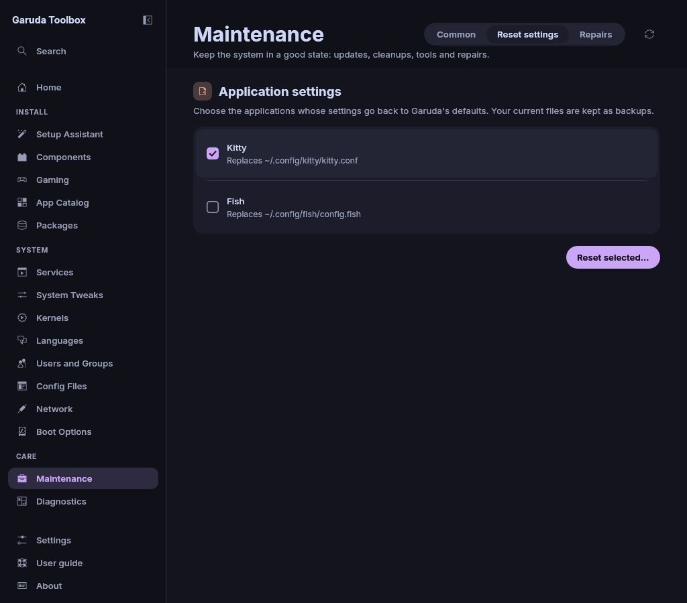

# Maintenance

The **Maintenance** page updates and cleans up packages, refreshes mirrors
and resets application settings. Open it with **Maintenance** in the
sidebar. It has three tabs at the top right: **Common**, **Reset settings**
and **Repairs**. The round arrow beside them, **Read again** (or `F5`),
checks which tools are installed and reads the system again, for example
after you installed a tool elsewhere.

## Update and clean up

The rows under **Package care** on **Common** change the system:

| Row                        | What it does                                                                              |
| -------------------------- | ----------------------------------------------------------------------------------------- |
| **Update system**          | Updates every package, with `garuda-update` when it is installed, else with `pacman -Syu` |
| **Remove orphans**         | Removes packages that were installed as dependencies and are no longer needed             |
| **Clean package cache**    | Deletes cached packages of software that is no longer installed (`paccache -ruk0`)        |
| **Refresh keyring**        | Downloads the newest signing keys of the package repositories                             |
| **Remove the pacman lock** | Deletes a lock left behind by an interrupted update                                       |

Each row has **Run now** and a **⋯** button:

- **Run now** runs it at once and shows the **Console**.
- The **⋯** menu holds **Queue** and the action, for example **Queue
  update** or **Queue removal**. It puts the row into the queue, so it
  runs with your other changes. The menu then says **Remove from queue**.
  Click it to take the row out of the queue again.

Queued rows run in a fixed order, whatever order you queued them in: the
keyring and the lock first, then the update. The clean-up runs after all
other queued system changes, so it also catches what a queued package
removal leaves behind.

> **Note:** **Remove the pacman lock** does nothing while pacman runs. The
> lock protects a running update, and removing it then could damage the
> package database.

**Remove orphans** and **Clean package cache** ask first, with a red
button, because they delete packages. Orphan removal also lets pacman list
the packages and ask in the Console before it removes them.

All five need your password. While changes are applied, the buttons wait
for the end and a note at the top says so.

## Open a tool

The rows under **Tools** on **Common** open tools in their own window. When a
tool is missing, its button says **Install and open…** and the row says that
the installation starts at once. Click it: the installation runs in the
**Console** and asks for your password, and the tool opens when the
installation succeeded. For
**Refresh Chaotic-AUR mirrors** the ranking starts instead.

| Row                             | Tool                                                         |
| ------------------------------- | ------------------------------------------------------------ |
| **Refresh Arch mirrors**        | reflector-simple, to choose the fastest Arch Linux mirrors   |
| **Refresh Chaotic-AUR mirrors** | rate-mirrors, see below                                      |
| **Btrfs Assistant**             | Manages snapshots and Btrfs maintenance                      |
| **Edit repositories**           | pace, to turn package repositories on or off                 |
| **Merge configuration updates** | Compares and merges `.pacnew` and `.pacsave` files with meld |

**Refresh Chaotic-AUR mirrors** ranks the Chaotic-AUR mirrors by speed in
the background. While it works, the row says **Testing the mirrors. This
takes up to five minutes. The Console opens when the new list is ready.**
and its button is greyed out. You can use the other pages meanwhile. When
it is done, the app asks for your password and saves the new list to
`/etc/pacman.d/chaotic-mirrorlist`. The old list is kept as
`/etc/pacman.d/chaotic-mirrorlist.bak`.

### When a tool does not start

A red note at the top of the page says what went wrong, with the system's
own reason where it gave one. **Dismiss** on the note removes it.

| Note                                                                                 | What to do                                                                |
| ------------------------------------------------------------------------------------ | ------------------------------------------------------------------------- |
| The name of the row and **could not be started because it is not installed**         | Install the tool's package again                                          |
| The name of the row and **could not be started because this account may not run it** | Check the rights of the program                                           |
| The name of the row, **could not be started** and a reason                           | Read the reason. Reinstall the tool's package when its program is damaged |
| **Ranking the Chaotic-AUR mirrors took longer than five minutes**                    | Try again later, or with a faster connection                              |
| **The ranking program rate-mirrors could not be started**                            | Reinstall the package `rate-mirrors`                                      |
| **Ranking the Chaotic-AUR mirrors failed**                                           | Check your internet connection and click the button again                 |
| **Ranking gave no usable list of mirrors**                                           | Try again. The list on disk is unchanged                                  |

In every case the Chaotic-AUR mirrorlist stays as it was. The reason is
also in the log file, see [Settings and About](settings.md).

## Reset application settings

**Reset settings** puts the settings of applications back to Garuda's
defaults from `/etc/skel`. Only applications whose defaults exist on your
system are listed.

1. Tick the applications, for example **Fish** or **Kvantum**. Under each
   name, **Replaces** names the files of your home it resets. A long list
   ends in "…". Point at the row to read all of it.
2. Click **Reset selected…**.
3. Read the list of files in **Reset 2 settings?** (the number is how many
   you ticked) and click **Reset**.

Your current files are not lost. Each one is renamed first, to the old name
plus `.bak-` and the date and time, for example
`~/.config/fish/config.fish.bak-20261009-153012`. A note above the list
says when the reset is done, or names the applications it could not reset.

When the system has no Garuda defaults, the tab shows **No default
settings found**.

## Repair a broken system

**Repairs** runs Garuda's repair tools. They run in the **Console**, where
they can ask their questions. All but **System health check** need your
password.

| Row                                | Runs                                 |
| ---------------------------------- | ------------------------------------ |
| **System health check**            | `garuda-health`                      |
| **Repair system health**           | `garuda-health --fix`                |
| **Reset package manager settings** | `garuda-update remote fix`           |
| **Reset keyring**                  | `garuda-update remote keyring`       |
| **Full reset**                     | `garuda-update remote fullfix`       |
| **Reset audio**                    | `garuda-update remote reset-audio`   |
| **Reset Snapper**                  | `garuda-update remote reset-snapper` |
| **Reinstall packages**             | `garuda-update remote reinstall`     |

> **Warning:** **Full reset** and **Reinstall packages** reinstall every
> package. This takes a long time and downloads a large amount of data.

**Reset package manager settings**, **Full reset**, **Reset audio**,
**Reset Snapper** and **Reinstall packages** ask first. The question says
what is lost, for example that **Reset Snapper** deletes every snapshot.
The red button with the repair's name runs it. **Cancel** or `Esc` leaves
the system as it is.

Every row is shown. A row whose program is missing is greyed out and says
what it needs, for example **Needs garuda-update**. When garuda-update is
missing, the tab says so above the rows and offers
**Install garuda-update**. The installation starts at once in the Console and
asks for your password. The rows unlock once it is done.

## See also

- [Review and apply changes](applying.md)
- [The Console](console.md)
- [The command line](cli.md)
