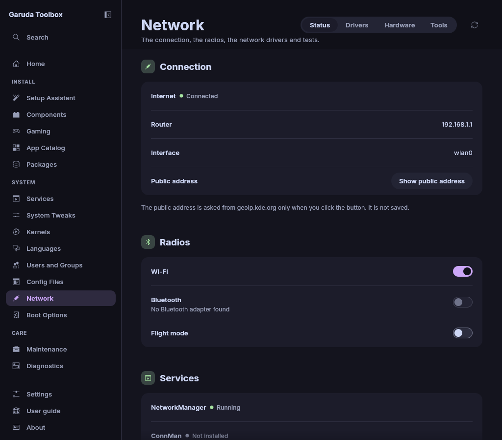

# Network

**Network** shows how this computer is connected, switches its radios,
manages network drivers, lists network hardware and runs connection tests.
It has four tabs: **Status**, **Drivers**, **Hardware** and **Tools**.

**Read again** (the round arrow beside the tabs, or `F5`) reads everything
again. The page also reads again after every run in the Console.

## Check the connection

The **Status** tab starts with **Connection**, with **Radios** and
**Services** below it.

| Line               | What it shows                                                      |
| ------------------ | ------------------------------------------------------------------ |
| **Internet**       | What NetworkManager says about the way to the internet (see below) |
| **Router**         | The address of the default router                                  |
| **Interface**      | The network interface the default route uses, for example `wlan0`  |
| **Public address** | Only after you ask for it (see below)                              |

**Internet** is one of these:

| Text                           | Meaning                                                      |
| ------------------------------ | ------------------------------------------------------------ |
| **Connected**                  | The internet is reachable                                    |
| **Network only, no internet**  | A network is there, but it has no way to the internet        |
| **A login page is in the way** | A hotspot wants you to log in first. Open a browser to do so |
| **Not connected**              | No network                                                   |
| **Unknown**                    | NetworkManager does not run, or it does not check            |

The answer comes from NetworkManager's own connectivity check. Garuda
Toolbox sends no test packets by itself. On a system that uses another
network manager the line stays **Unknown**.

**Router** and **Interface** show **None** without a default route and
**Not available** when the `ip` program is missing.

## Show the public address

Your public address is the one the internet sees, usually the address of
your router.

1. Click **Show public address**.
2. The address appears under **Public address**. **Copy** puts it on
   the clipboard. **Hide** in the **⋯** menu beside it takes it off the
   page again.

> **Note:** The click sends one request to `geoip.kde.org`, KDE's own
> service. That service sees your address. Garuda Toolbox reads only the
> address from the answer and saves nothing. Without the click nothing is
> sent.

**Could not be found out** means there was no answer, for example without
an internet connection. **Try again** asks once more.

## Switch Wi-Fi, Bluetooth and flight mode

Under **Radios** on the **Status** tab:

- **Wi-Fi** and **Bluetooth** switch that radio on or off.
- **Flight mode** switches every radio off, or all of them on again.

The switches use `rfkill`, the kernel's radio switch, with your own
rights, without a password. They show what the system says, so a switch
that could not be made flips back.

A switch is greyed out when:

- the computer has no such radio (**No Wi-Fi adapter found**, **No
  Bluetooth adapter found**),
- a key or switch of the computer holds the radio off (**Switched off by a
  key or switch of the computer**), which only that key undoes,
- your session may not switch radios. The page then says **This session is
  not allowed to switch radios. Log in at the computer itself, or ask an
  administrator.** This happens in remote sessions such as SSH.

## Start a network service

**Services** on the **Status** tab lists NetworkManager, ConnMan,
Bluetooth and the location service (GeoClue) with their state:
**Running**, **Stopped**, **Failed**, **Not installed** or **Starts on
demand**.

To start a stopped service, click **Start** next to it. This runs at once
in the [Console](console.md) and asks for your password.

The location service has no button: it starts by itself when an app asks
for your position. To make a service start at every boot, use
[Services](services.md).

## Manage network drivers

The **Drivers** tab lists the network drivers (kernel modules) of the
running kernel. Search by name with the field under the tabs, or narrow
the list with the two rows of chips: one for the state and one for the kind
(**Ethernet**, **Wireless**, **Bluetooth** or **Other**). **All** in a row
shows every driver again.

| State                   | Meaning                                                  |
| ----------------------- | -------------------------------------------------------- |
| **Loaded**              | The driver is loaded and runs                            |
| **Blacklisted**         | A file tells the system not to load the driver by itself |
| **Available**           | The driver is on the disk and not loaded                 |
| **Loaded, blacklisted** | Runs now, but will not load by itself at the next start  |

### Load or unload a driver

Click **Load** or **Unload…** on its row. **Unload…** asks first, because
every device the driver runs stops at once. Both run at once in the Console
and ask for your password. NetworkManager is stopped first and started
again afterwards, whatever happens in between. On a system
without NetworkManager or without a running `wpa_supplicant` the step
fails: load the driver with `modprobe` in a terminal there.

> **Warning:** Unloading the driver of the connection you are using cuts
> that connection. Click **Load** to bring it back, or restart the
> computer.

### Keep a driver from loading

1. Open the **⋯** menu of the driver's row and click **Queue blacklist**.
   The row shows **Queued: add to the blacklist**.
2. Apply the queue (see [Review and apply changes](applying.md)).

Garuda Toolbox adds the driver to its own file
`/etc/modprobe.d/garuda-toolbox-blacklist.conf`. From then on the system
does not load the driver by itself. A driver that is loaded stays loaded
until you click **Unload** or restart.

To undo it, click **Queue removal from blacklist** in the same menu and
apply. While a change waits in the queue, **Take back** in the menu
removes it from the queue.

Some drivers are blacklisted by other files, for example by a package
such as `broadcom-wl`. Their row names the file and says that Garuda
Toolbox does not change it, so there is no **⋯** menu. Remove the package,
or edit a file in `/etc/modprobe.d` yourself in
[Config Files](config-files.md).

### When the list is empty

**No network drivers found** appears when the modules of the running
kernel are not on the disk. That is normal right after a kernel update:
restart the computer first.

**No driver matches** means the search or the filters hide every driver.
**Clear search** empties the search field. When the drivers could not be
read, **Read again** reads them again.

## List network hardware

The **Hardware** tab lists the Ethernet, wireless and Bluetooth devices
that `lspci` and `lsusb` report. People who help in the forum ask for this
information. A USB device counts as Bluetooth when one of its interfaces
has the Bluetooth class in `/sys/bus/usb/devices`, even when its name says
only "Wireless", as with the Bluetooth part of a MediaTek MT7922 card.

- **Copy this line** on a row copies that device's line.
- **Copy all** copies every line.

When a list is missing, the tab says which program is not installed:
`lspci` comes with the package `pciutils`, `lsusb` with `usbutils`. When
no device is listed at all, the empty list says so. Otherwise a note
above the list does. When a program failed, **Read again** reads the devices
again. A short note at the top right confirms each copy.

## Test a connection

On the **Tools** tab under **Connection tests**:

1. Enter a name or an IP address in **Host**. It starts with
   `garudalinux.org`.
2. For a ping, set **Number of pings** (1 to 100) and **Timeout in
   seconds** (1 to 60), then click **Run ping** under the form.
3. For the route to the host, set **Most hops (for traceroute)** (1 to 255)
   and click **Run traceroute** beside it.

Both run with your own rights and show their output in the Console. Click
**Cancel** there to stop one early.

When the host is not a name or address, the buttons are greyed out and
the **Host** row says **Enter a host name or an IP address, for example
garudalinux.org.**

**Run traceroute** is greyed out while the package `traceroute` is not
installed, and the tab says so. Install it with your package manager.

## Share the connection as a Wi-Fi hotspot

Under **Wi-Fi hotspot** on the **Tools** tab:

- **Queue hotspot tool** puts the package `linux-wifi-hotspot` into the
  queue. Apply the queue to install it.
- **Open hotspot** starts the tool in its own window once it is installed.

When the installed packages could not be read, the button is greyed out and
a note under it says so. **Read again** reads them again.

## See also

- [Services](services.md)
- [System Tweaks](system-settings.md) for the DNS server and the Wi-Fi
  backend
- [Diagnostics](diagnostics.md)
- [The Console](console.md)
- [The command line](cli.md)
