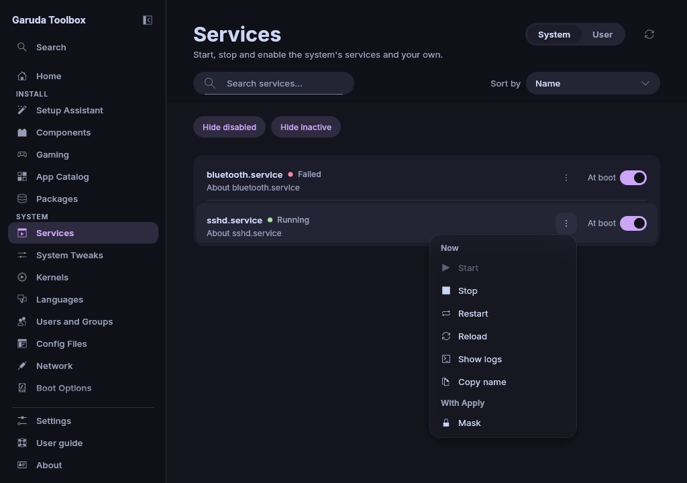

# Services

**Services** lists the system's services, or your own (user) ones, and
lets you start, stop and set them up. A service here is anything systemd
starts: background programs, sockets that wait for a connection, timers and
mounts. systemd calls all of them "units".

## Finding a service

- The tabs **System** and **User** beside the page title switch between the
  system's services and the ones of your own session. **Settings** can open
  the page on **User**.
- Type in the search field under the title to filter by name or
  description. The button at its end clears the search.
- **Hide disabled** leaves out services that are installed but not enabled
  (on by default). Click it to list them too.
- **Hide inactive** leaves out services that are not running (on by
  default). Failed services are always listed because they usually need a
  look.
- **Sort by** at the right of the search orders the list by **Name** (the
  default) or **Problems first**. With **Problems first** the failed services
  come first, then those that are starting, stopping or reloading, then the
  running ones grouped by what they do, then the stopped ones. Services in
  the same state stay in the order of their names.
- **Read again** (the round arrow beside the tabs, or `F5`) reads the list
  again.

The list follows changes as they happen, also when something outside the
app starts or stops a service.

Each row shows the service's description first and its file name below.
Hover over a row, or move the keyboard focus to it, to see both in full.
Beside the name, a coloured dot and a word say whether the service runs
(**Running**, **Stopped**, **Failed**, …). The **At boot** switch at the
right says whether it starts at boot. Services that cannot simply be
switched on at boot say why instead:

| Word                | Meaning                                                       |
| ------------------- | ------------------------------------------------------------- |
| **Static**          | Cannot be enabled. It starts when another service needs it    |
| **Indirect**        | Starts through another service or a timer                     |
| **Generated**       | Made at boot from another file, for example `/etc/fstab`      |
| **Masked**          | Blocked: it cannot be started at all, not even by another one |
| **Linked**          | Its file lies outside the service folders and is linked in    |
| **Alias**           | Another name of a service listed under its own name           |
| **Temporary**       | Made by a program while it runs, gone after a restart         |
| **Unreadable file** | systemd could not read its file                               |

Where systemd knows more than "runs" or "does not run", the row adds it in
brackets:

| The row says                                 | Meaning                                                           |
| -------------------------------------------- | ----------------------------------------------------------------- |
| `Active (finished)`                          | A one-time job that did its work. No process is left, as expected |
| `Running (listening)`                        | A socket that waits for a connection and then starts its service  |
| `Running (waiting)`                          | A timer or path unit that waits for its moment                    |
| `Running (active)`, `(mounted)`, `(plugged)` | A target, a mounted file system or a device that is there         |
| `Failed (restarting)`                        | A service that failed and is started again by systemd             |
| **Unknown state**                            | A state newer than this app                                       |

A plain **Running**, **Stopped** or **Failed** means there is nothing to add.

## Acting on a service

At the right of each row, the switch captioned **At boot** queues whether
the service starts at every boot. Left of it, the button with three dots
opens the row's actions. Its tooltip names the service. With the keyboard,
press the `Menu` key or `Shift+F10` on the row. `Space` flips **At boot**. The
menu has two parts.

Under **Now**, the actions run at once and show their output in the
Console:

| Action        | What it does                                       |
| ------------- | -------------------------------------------------- |
| **Start**     | Starts the service now. Greyed out while it runs   |
| **Stop**      | Stops it now. Greyed out while it is stopped       |
| **Restart**   | Stops and starts it                                |
| **Reload**    | Asks a running service to reload its configuration |
| **Show logs** | The last 500 lines of its log                      |

Two changes go into the queue, like Components, and **Apply** makes them
with one password for everything queued:

| Control                                                 | What it does                                                          |
| ------------------------------------------------------- | --------------------------------------------------------------------- |
| The **At boot** switch                                  | Starts the service at every boot, and now, or stops both              |
| **Mask** / **Unmask**, under **With Apply** in the menu | A masked service cannot be started at all, not even by other services |

While a change waits, the row says so, for example **Masks with Apply**.
Turning the switch back, or picking the same menu entry again, takes the
change out of the queue.

System services need your password. Your own (user) services do not.

Stopping, restarting or masking a service the session lives on (the login
screen, NetworkManager, the password dialog's polkit, the system bus or
systemd-logind) asks first, with the risk named and a red button.

## When the list stays empty

- **systemd is not reachable** means the app could not talk to systemd,
  for example inside a container.
- **You are not allowed to read the services** means the system refused
  the request.
- **The services could not be read** means the request failed for another
  reason.

**Retry** tries again. **No service matches.** means the search or the
filters hide everything. The ✕ in the search field empties it.

## See also

- [Review and apply changes](applying.md)
- [The Console](console.md)
- [The command line](cli.md)
