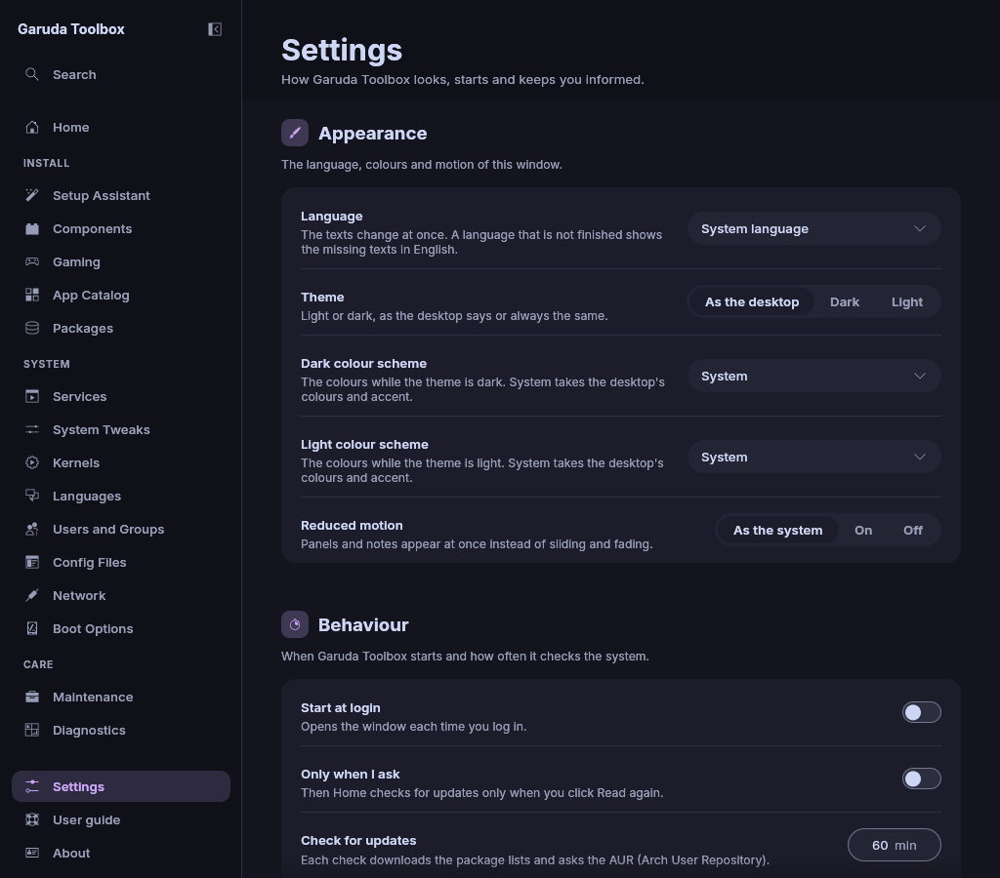
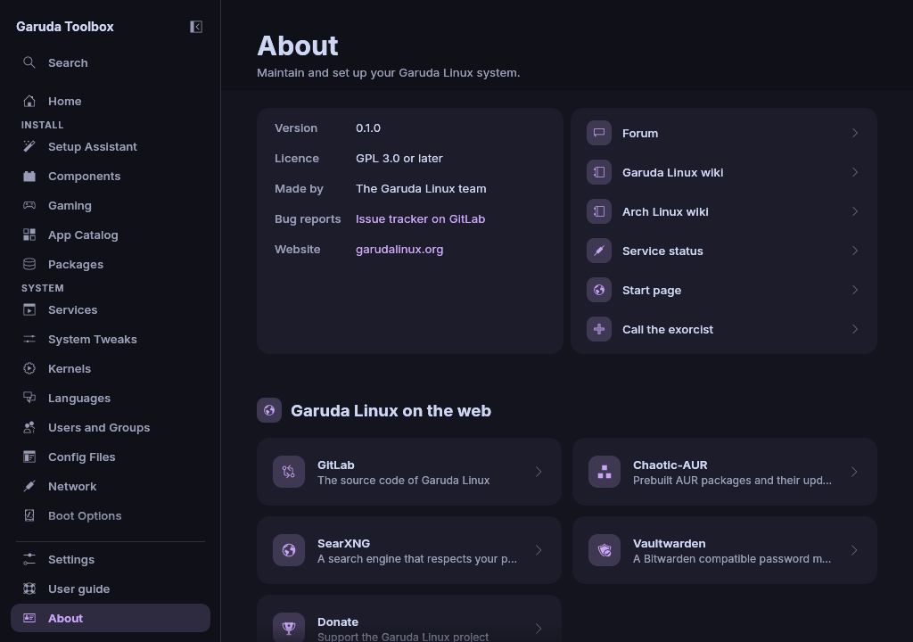

# Settings and About

## Settings

Open **Settings** at the bottom of the sidebar. The page has three
sections: **Appearance**, **Behaviour** and **Diagnostics**. Every change
is kept at once and takes effect at once.

| Setting                           | Choices                                                                                                                                 |
| --------------------------------- | --------------------------------------------------------------------------------------------------------------------------------------- |
| **Language**                      | **System language** (default) or one of the languages the app is translated into. See below                                             |
| **Theme**                         | **As the desktop** (default), **Dark** or **Light**                                                                                     |
| **Dark colour scheme**            | **System** (default) or one of the app's dark colour schemes. See below                                                                 |
| **Light colour scheme**           | **System** (default) or one of the app's light colour schemes. See below                                                                |
| **Reduced motion**                | **As the system** (default), **On** or **Off**. **On** shows panels and notes at once instead of sliding and fading them                |
| **Start at login**                | On or off (default). On opens the window each time you log in                                                                           |
| **Check for updates**             | Every 5 to 1440 minutes, 60 by default, or **Only when I ask**                                                                          |
| **Services page opens on**        | **System** (default) or **My account**. **My account** opens [Services](services.md) on **User** at once                                |
| **Show AUR packages**             | On or off (default). On adds the **AUR** chip to [Packages](packages.md#packages-from-the-aur), whose list downloads at most once a day |
| **Copy reports to the clipboard** | On or off (default). On copies every finished [Diagnostics](diagnostics.md) report and the link of an uploaded one                      |
| **Log file detail**               | **Errors only**, **Warnings and errors**, **Normal** (default), **Detailed**, **Everything**                                            |

Pick **Detailed** under **Log file detail** before you report a problem.
The log file is `~/.local/state/garuda-toolbox/garuda-toolbox.log`.

### Check for updates less or more often

Type the minutes between two checks into **Check for updates** and press
`Enter`. Each check downloads the package lists and asks the AUR (Arch User
Repository), so a check every few minutes costs data and time. A number
below 5 or above 1440 (a day) is held to the nearest limit, and the row
says so, for example **Checks run between every 5 minutes and once a day,
so this is 5 minutes.**

**Only when I ask** turns the timed checks off. Turn it on to check only
when you press **Read again** on [Home](home.md). While it is on, the
minutes field is greyed out. Turned off again, the checks run on the minutes
they had before.

### Change the language

Pick a language under **Language**. The texts change at once, without a
restart. **System language** follows the language of your desktop
session again. Each language shows under its own name, for example
**Deutsch (Deutschland)**. A text that is not translated yet shows in
English.

> **Note:** Programs that run in the **Console** print in the language of
> your system, not in the one chosen here.

### Pick a colour scheme

By default the window takes the colours and the accent of your desktop.
To use one of the app's own colour schemes instead, pick it under **Dark
colour scheme** or **Light colour scheme**. The colours change at once.

| Picker                  | Colour schemes                                                                                                                                                                                         |
| ----------------------- | ------------------------------------------------------------------------------------------------------------------------------------------------------------------------------------------------------ |
| **Dark colour scheme**  | Catppuccin Frappé, Catppuccin Macchiato, Catppuccin Mocha, Nord, Dracula, Sweet, Tokyo Night, Gruvbox Dark, Solarized Dark, Rosé Pine, Rosé Pine Moon, Everforest Dark, One Dark, Ayu Dark, Ayu Mirage |
| **Light colour scheme** | Catppuccin Latte, Tokyo Night Day, Nord light, Dracula Alucard, Gruvbox Light, Solarized Light, Rosé Pine Dawn, Everforest Light, Ayu Light                                                            |

**Theme** still decides which of the two shows: the dark scheme while the
window is dark, the light one while it is light. A picked scheme replaces
all of the desktop's colours, its accent too, and also colours the icon
tiles and the **Console**'s terminal. Text that would be hard to read
on a scheme's colours is made darker or lighter until it reads well.

To go back to the desktop's colours, pick **System**.

> **Note:** On a desktop the app cannot read colours from, **System**
> shows the app's fallback colours, Catppuccin Mocha for dark and Latte for
> light, with their mauve accent.

### Start the app at login

**Start at login** adds Garuda Toolbox to your desktop's autostart: a link
named `garuda-toolbox.desktop` in `~/.config/autostart`. Turning it off
removes the link again. It needs no password, and it only affects your
user. The switch shows whether the link was there when the app started.

### Where the settings are kept

**Language**, **Dark colour scheme**, **Light colour scheme**, **Check
for updates**, **Services page opens on**, **Show AUR packages**, **Copy
reports to the clipboard** and **Log file detail** live in
`~/.config/garuda-toolbox/settings.toml`,
which `garuda-toolbox settings` also changes. A running window takes such a
change at its next start. **Theme** and **Reduced motion** are kept with the
window's own state in `~/.local/share/garuda-toolbox/app.ron`, together
with the window's size.

When a setting cannot be written, a note says **A setting could not be
saved.** and the log file says why.

## About

Open **About** at the bottom of the sidebar. The page shows:

- The **Version**, **Licence**, who made the app, where to send **Bug
  reports** (the **Issue tracker on GitLab**) and the **Website**. The
  version and the two addresses have a copy button, shown when the pointer
  rests on the row or the button has the keyboard focus. Paste the version
  into a bug report.
- Beside it, the places to find help: **Garuda Linux wiki**, **Arch
  Linux wiki** and **Service status**, each opened in your browser. **Call the exorcist** is for desperate moments. It
  opens a small dialog that points to the forum and the issue tracker.
- **Garuda Linux on the web**: Start page, GitLab, Chaotic-AUR,
  SearXNG, Vaultwarden and Donate.
- **Community**: Forum, Telegram, Discord, Mastodon and Bluesky.

When a link does not open, for example because no browser is set up, a
note says **The link did not open.**

## See also

- [Diagnostics](diagnostics.md)
- [The command line](cli.md)
