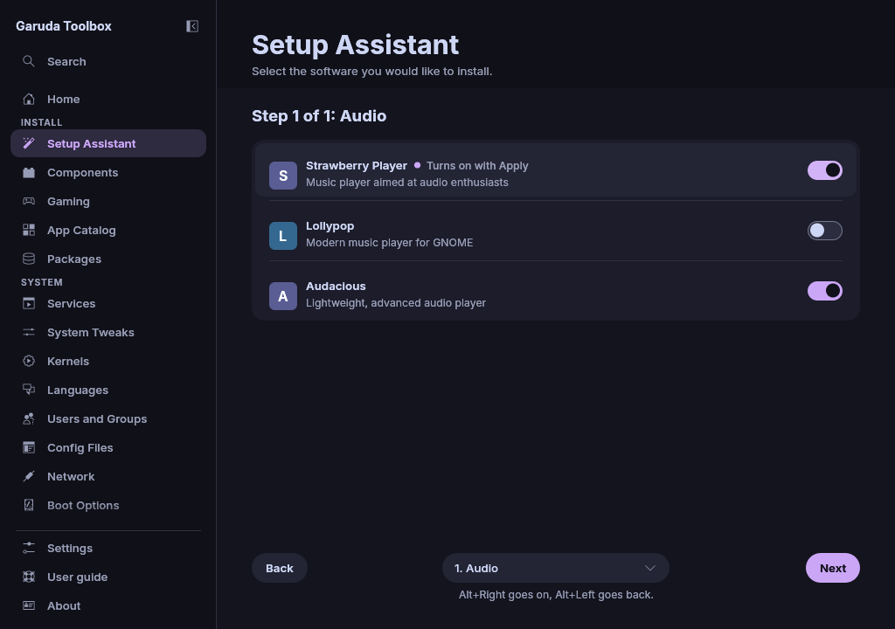

# Setup Assistant

The **Setup Assistant** walks you through the apps most people want on a
fresh system, one category at a time: music players, browsers, chat and
mail apps, development tools, games, graphics, input methods, kernels,
office suites, video tools, virtualization and more. At the end you review
your choices and install them all at once.

Open it from the sidebar or from **Next steps** on Home. You can also
start the app with `garuda-toolbox --setup-assistant`, which opens
the assistant directly.

## Pick your apps

1. The first page explains what happens and how many categories there are.
   Click **Next**.
2. Each step shows the apps of one category as rows with an icon, a name
   and a short description. Turn on the switch of a row to pick the app.
   The row says **Turns on with Apply**.
3. Click **Next** to go on, also when you want nothing from a category.
   **Back** returns to the step before. Your picks stay.
4. To go straight to a category, open the list between **Back** and
   **Next** and choose it. The list holds **Welcome**, every category with
   its number and the **Summary**, and always shows where you are. Your
   picks stay here too.

**Back**, the list and **Next** stay at the bottom of the page, also when a
category has more apps than fit, so you can reach them without scrolling.

The heading names the step, for example "Step 1 of 16: Audio". The count
is the number of categories the first page names. After the last category
comes the **Summary**.

Nothing is installed while you pick. Every choice goes into the same queue
the other pages use, and the queue is kept when you leave the assistant or
close the app.

## Remove apps you do not want

Apps that are already installed show as checked. Turn one off and its row
says **Turns off with Apply**. It is removed together with the rest when you
apply.

> **Note:** Removing an app also removes the dependencies nothing else
> needs. Turn the switch on again before you apply to keep the app.

## What comes along with an app

Some apps bring more than one package, and a few need a service:

- Cockpit, Docker, Podman, GNOME Boxes and Virtual Machine Manager also
  enable their system service (for example `docker.socket` or
  `libvirtd.service`), so they work right after the apply. Podman also
  enables `podman.socket` for your user.
- The kernels come with their headers, so DKMS modules build for them.
- The Fcitx5 input methods all bring `fcitx5-configtool`. It stays as long
  as one of them is picked or installed.

The **Summary** and **Review** show the services next to the apps.

## LibreOffice Fresh or Still

LibreOffice comes in two branches that cannot be installed side by side.
Picking **LibreOffice Fresh** turns off **LibreOffice Still** and the other
way round. When the other branch is installed, it is queued for removal.

## Check the summary and apply

1. The **Summary** step lists **Apps to install**, **Apps to remove** and
   **Services to enable**, each with a count and the names.
2. Click **Review and apply**. **Review** opens with every queued change,
   also those you queued on other pages. The changes pill is hidden on every
   step, so **Review and apply** is the one way to apply here.
3. Click **Apply**. The app asks for your password once and installs,
   removes and enables everything in the Console. See
   [Review and apply changes](applying.md).

When the apply worked and the queue is empty again, the assistant shows
**Success!** and recommends a restart. **Restart…** restarts the computer
after one more question. **Finish setup** returns to Home. Below them,
buttons open the **Garuda forum**, the **Garuda Linux wiki** and the
**Arch Linux wiki** in your web browser. The changes pill stays hidden on
this page.

When every pick was already in place, the page says so instead of calling
the system ready. In test mode it says that nothing was installed or
changed.

When you picked nothing, the Summary says so and the button reads
**Finish**. It shows **Success!** without changing anything.

When a step of the apply fails, the Console shows the error and the
assistant stays where it was. What did not run stays in the queue, so you
can fix the cause and apply again from **Review**.

## Use the keyboard

| Key         | What it does                                  |
| ----------- | --------------------------------------------- |
| `Alt+Right` | **Next**, on the Summary **Review and apply** |
| `Alt+Left`  | **Back**                                      |
| `Tab`       | Moves through the switches and the buttons    |
| `Space`     | Turns the focused switch on or off            |

After **Next** or **Back** the focus stays where it was, so the keys work
from anywhere on the page.

## Why some apps or steps are missing

The assistant only shows apps your system can install: packages the
repositories in `/etc/pacman.conf` offer, plus anything already installed,
so you can still remove it. A category without such apps is skipped, and
the step count shrinks with it.

- Many apps come from the Chaotic-AUR repository that Garuda Linux
  enables, for example `brave-bin` or the `linux-cachyos` kernel. On other
  Arch based systems without it they are hidden.
- The list comes from the package databases as pacman last downloaded
  them. After you add a repository, update the system once (see
  [Maintenance](maintenance.md)) to see its apps here.
- On a system without pacman databases the app cannot tell, so every app
  shows and a warning at the top says their state could not be read.

The icons come from your icon theme, then from the AppStream data of the
repositories, as on [App Catalog](discover.md).

## See also

- [App Catalog](discover.md)
- [Gaming](gaming.md)
- [Components](components.md)
- [Review and apply changes](applying.md)
- [The command line](cli.md)
