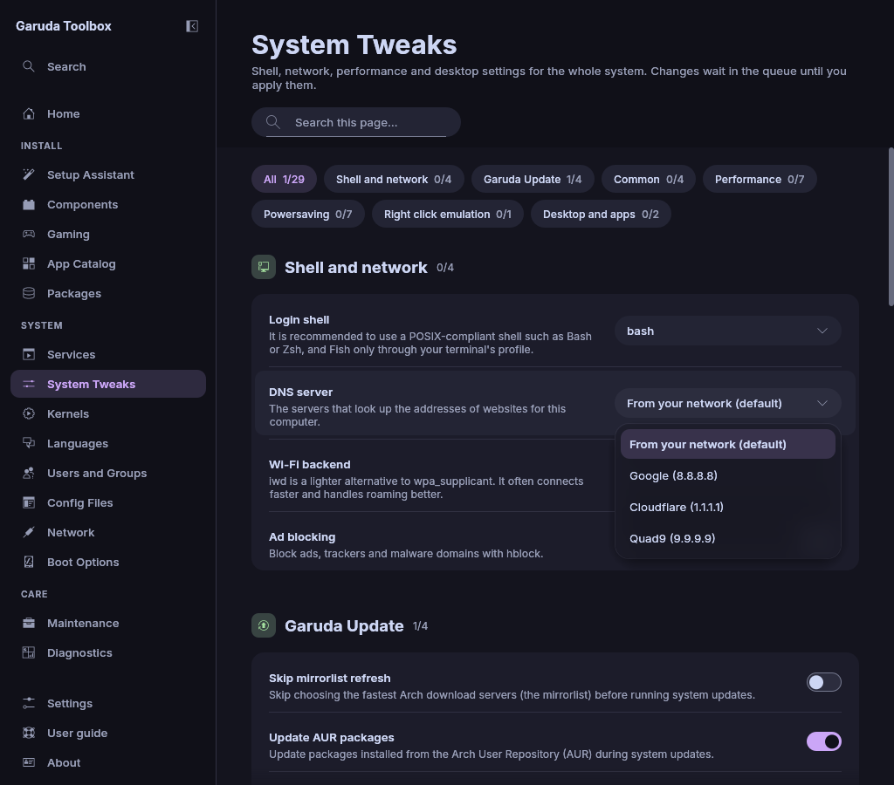

# System Tweaks

**System Tweaks** changes how your system works: your login shell, the DNS
server, the Wi-Fi backend, ad blocking, the options of `garuda-update`,
and settings of your desktop and apps.

A changed control shows **Changes with Apply**. Changes wait in the queue
until you apply them, see [Review and apply changes](applying.md).

## Find a tweak

Type in **Search this page…** above the rows. Only the rows whose name or
description holds the text stay.

## Change your login shell

1. Pick a shell under **Login shell**, for example `zsh`.
2. Apply the queue.

The list shows each shell by its program name. Hover over the list to see the
whole path. Where `/etc/shells` names one program by two paths, such as
`/bin/bash` and `/usr/bin/bash`, both paths show in full.

The list holds only the shells `/etc/shells` names, and the app checks that
list again just before it runs `chsh`. The new shell starts with your next
login. Use a POSIX-compliant shell such as Bash or Zsh as login shell, and
start Fish only through your terminal's profile.

## Choose a DNS server

Pick one under **DNS server**:

| Choice                          | What it does                                              |
| ------------------------------- | --------------------------------------------------------- |
| **From your network (default)** | Uses whatever your connection hands out, usually your ISP |
| **Google (8.8.8.8)**            | Asks Google's resolver                                    |
| **Cloudflare (1.1.1.1)**        | Asks Cloudflare's resolver                                |
| **Quad9 (9.9.9.9)**             | Asks Quad9's resolver                                     |

The app writes the choice to
`/etc/NetworkManager/conf.d/10-garuda-assistant-dns.conf` and reloads
NetworkManager. The default removes that file again. Choices made with the
old Garuda Assistant use the same file, so they show here.

## Switch the Wi-Fi backend

Pick **wpa_supplicant (default)** or **iwd** under **Wi-Fi backend**. iwd is
a lighter alternative to wpa_supplicant. It often connects faster and handles
roaming better.

> **Warning:** The switch stops NetworkManager for a moment, so your network
> drops while it applies. NetworkManager is started again even when a step in
> between fails.

Switching to iwd installs the `iwd` package first, then masks
`wpa_supplicant`. Switching back unmasks and starts it again.

## Block ads with hblock

Turn on **Ad blocking**. The apply installs `hblock` when it is missing,
enables its timer and fills `/etc/hosts` with the block list. Turning it off
disables the timer and empties the block list again.

## Set the options of garuda-update

The **Garuda Update** switches change `/etc/garuda/garuda-update/config`,
which `garuda-update` reads on every system update:

| Option                      | Line in the configuration |
| --------------------------- | ------------------------- |
| **Skip mirrorlist refresh** | `SKIP_MIRRORLIST=1`       |
| **Update AUR packages**     | `UPDATE_AUR=1`            |
| **Non-interactive pacman**  | `PACMAN_NOCONFIRM=1`      |
| **Skip disk space check**   | `NO_SPACE_CHECK=1`        |

Turning an option off comments its line out. Every other line of the file
stays as it is. Older toolbox versions wrote `NO_CHECK_SPACE=1` for the
space check. `garuda-update` still reads that name while `NO_SPACE_CHECK` is
unset, so the switch shows it as on, and turning the switch off comments it
out too. The section shows only where `garuda-update` is installed.

## Turn system tweaks on or off

Below the choices, rows in the sections **Common**, **Performance**,
**Powersaving** and **Right click emulation** work like the
[Components](components.md) page: each row is a package or a service, its
switch shows whether it is on, and flipping it queues the change.
Examples are `profile-sync-daemon`, `ananicy-cpp`, `thermald` and
`power-profiles-daemon`.

A service row needs its package first. Its switch stays greyed out and the
row says **Needs …** until the package is on or queued.

## Change settings of your desktop and apps

The **Desktop and apps** section edits configuration files in your home
folder:

| Card                            | What it changes                                                                                                                   |
| ------------------------------- | --------------------------------------------------------------------------------------------------------------------------------- |
| **Audio no-suspend**            | Writes `~/.config/wireplumber/wireplumber.conf.d/disable-suspension.conf`, which keeps sound devices awake. Off removes the file. |
| **KDE borderless maximize**     | Sets `BorderlessMaximizedWindows=true` in the `[Windows]` group of `~/.config/kwinrc`. Off sets it to `false`.                    |
| **Disable Discord auto-update** | Sets `"SKIP_HOST_UPDATE": true` in `~/.config/discord/settings.json`. Off removes that key.                                       |

These changes are queued like the others and run as you, not as root, so
they need no password. The file and its folders are created when they are
missing. Only the one setting changes: the rest of `kwinrc` and your other
Discord settings stay as they are. A file that is a link (for example from a
dotfile manager) stays a link, and the file it points to changes.

After **Audio no-suspend** changes, the apply restarts the `pipewire`,
`pipewire-pulse` and `wireplumber` user services, so sound stops for a
moment. **KDE borderless maximize** shows only on KDE Plasma. After it
changes, the apply tells KWin to read its settings again, so it works at
once. Restart Discord after changing its switch.

> **Note:** When `~/.config/discord/settings.json` holds something other than
> a JSON object, the apply leaves it alone and the step fails with the
> reason in the Console.

## When the state could not be read

A warning at the top says how many entries it concerns, with **Read
again**. The app could not read that part of the system, for example the
package list on a system without pacman, or a configuration file it may not
read.
You can still queue a change.

## See also

- [Review and apply changes](applying.md)
- [Components](components.md)
- [Services](services.md)
- [The Console](console.md)
- [The command line](cli.md)
