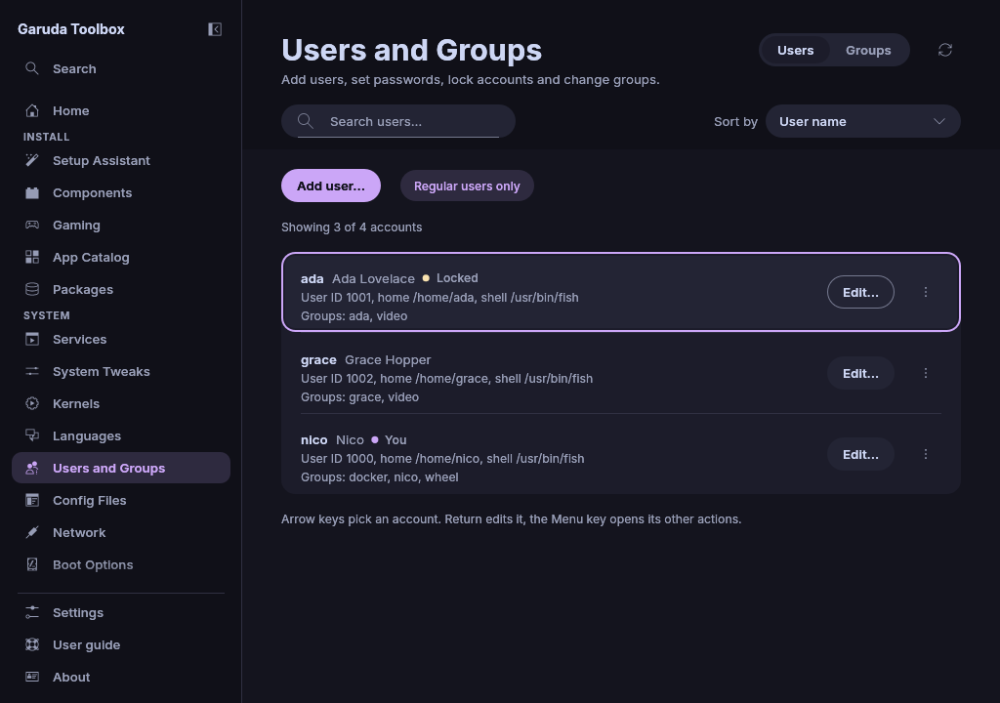

# Users and Groups

**Users and Groups** lists the accounts and groups of your system and lets you
add users, set passwords, lock accounts, change group memberships and remove
what you no longer need.

Most changes here wait in the queue until you apply them, see
[Review and apply changes](applying.md). A changed row says how many
changes wait, for example **1 change queued**.

Adding a user and setting a password run right away instead, because a
password is never kept in the queue. See
[Passwords are never stored](#passwords-are-never-stored).

## Find a user

The **Users** tab shows one row per account with its user name, full name,
user ID, home folder, login shell and groups. Every row has **Edit…** and
a button with three dots at its right. The dots open the other actions:
**Set password…**, locking, **Groups…** and **Remove…**. Right-click a row
for the same actions.

With the keyboard, press `Tab` to reach the list and pick a row with the
arrow keys. `Enter` opens **Edit…**, the `Menu` key or `Shift+F10` opens
the other actions, and `Tab` moves on to the buttons of the row.

- **Regular users only** (on at first) shows the accounts of people: user
  IDs from 1000 to 60000. Click the chip to also see the accounts of the system
  and its services. The line beside it counts both, for example
  `Showing 2 of 56 accounts`.
- **You** marks the account you are logged in with.
- **Locked** marks an account whose password is locked.
- **System** marks an account of the system or of a service: every account
  outside the user IDs 1000 to 60000.
- The search field finds users by user name, user ID, full name, home
  folder, login shell and group, without regard to upper and lower case.
  The button at its end clears it. When nobody matches, the page says so.
- **Sort by** at the right of the search field sorts by **User name** (at
  first), **User ID**, **Full name**, **Home folder** or **Login shell**.
  Accounts with the same value stay in the order of their names, and an
  empty full name or shell comes last.
- **Read again** (the round arrow at the top of the page, or `F5`) reads the
  accounts and the lock state again, for example after you changed an
  account in a terminal.

The lock state is kept in `/etc/shadow`, which only root may read. The app
reads it as root, after your password, and gets nothing but the user names
and whether each is locked, never a password hash. When it cannot be read,
a message above the list says that it does not know which accounts are
locked, and why. **Read again** asks again. Until then the lock entry
in a row's menu reads **Lock: state not known** and cannot be clicked: the
app cannot tell whether another administrator could still log in.

## Add a user

1. Click **Add user…**.
2. Enter a **User name**. It starts with a lowercase letter or an underscore
   and holds only lowercase letters, digits, hyphens and underscores, at most
   32 characters. The dialog says under the field what is wrong while you
   type, also when the name is taken. The other fields show their problems
   the same way.
3. Enter the password twice.
4. Tick **Administrator** when the user may install software and change the
   system. This puts the user into the group `wheel`. The box is missing when
   the system has no such group.

   The other fields are optional and wait under **More options**. Open it to
   change any of them.

5. Optionally enter a **Full name** and pick a **Login shell**. **System
   default** leaves the choice to the system. Only shells listed in
   `/etc/shells` are offered.
6. Optionally enter a **Home folder** as a full path such as
   `/srv/people/ada`. Left empty, the account gets the usual folder
   `/home/<user name>`. The path cannot hold `..`, a colon or a line break,
   and it cannot be the home folder of another account.
7. Optionally enter a **User ID**. Left empty, the system picks the next
   free one. An account of a person takes a number from 1000 to 60000, a
   system account one below 1000. A number another account has is refused.
8. Tick **No home folder** for an account that needs no files of its own,
   and **System account** for the account of a service. A system account is
   hidden by **Regular users only**.
9. Tick the other groups the user should be in beside its own one. The
   search field above the list finds a group by name.
10. Click **Add user now** and enter your own password when asked. The account
    is made right away and does not wait in the queue. While the button is
    greyed out, the text beside it says what it waits for, such as "Enter a
    password."

The page stays open. A message above the list says that the account is
being added, then whether it worked. Two steps run: `useradd` creates the
account, with its home folder unless you ticked **No home folder**, then
`chpasswd` sets the password. When the first step fails, the second does not
run. **Show Console** opens the Console with both steps, for example to read
why one failed. Afterwards the new user appears in the list.

> **Note:** Adding a user is not offered while changes are being applied.
> Wait until they are done.

## Set a password

1. Click the three dots on the user's row, then **Set password…**.
2. Enter the new password twice.
3. Click **Set password now** and enter your own password when asked.

The page stays open. A message above the list says that the password is
being set, then whether it worked. **Show Console** opens the Console with
the `chpasswd` step, for example to read why it failed. The user logs in
with the new password from then on.

### Passwords are never stored

A password you type goes straight from the dialog to the program that sets it
(`chpasswd`), on that program's input. It is not written to the queue, the
saved queue file, the Console, the log or the command line of any program,
and the dialog empties its fields when it closes. A password cannot hold a
line break or another control character and is at most 512 bytes long.

## Lock or unlock an account

Open the menu with the three dots on the user's row and click **Queue lock**
or **Queue unlock**, then apply the queue. The entry follows the account:
a locked account offers **Queue unlock**. Click **Don't lock** or
**Don't unlock** in the same menu to take it back before that. Your own
account has no lock entry.

Locking disables the password (`usermod -L`). The user can no longer log in
with it. Other ways in, such as an SSH key, keep working. Unlocking
(`usermod -U`) brings the old password back.

> **Note:** An account that never had a password cannot be unlocked. Set a
> password instead.

## Change the groups of a user

1. Click **Groups…** in the menu of the user's row (the three dots).
2. Tick the groups the user should be in and clear the others. Each line
   names the group with its group ID and the number of its members. The
   primary group is ticked and cannot be cleared. There is no way to tick
   every group at once, because that would also make the user an
   administrator and give it the groups of the system.
3. Click **Queue changes**, then apply the queue.

Each change runs `gpasswd -a` or `gpasswd -d`. It takes effect at the user's
next login.

## Change the full name or the login shell

1. Click **Edit…** on the user's row.
2. Change the **Full name** or pick another **Login shell**.
3. Click **Queue changes**, then apply the queue.

The full name cannot hold a colon, comma, equals sign, quotation mark or line
break. Room and phone numbers that the account has beside the name stay as
they are.

## Change or move the home folder

1. Click **Edit…** on the user's row.
2. Enter the new path in **Home folder**. It is a full path such as
   `/srv/people/ada`, without `..`, a colon or a line break, and not the home
   folder of another account.
3. Decide about the files with **Move the files to the new folder**. The
   dialog says below it what will happen.
4. Click **Queue changes**, then apply the queue.

| **Move the files to the new folder** | What applying does (`usermod`)                                                                                  |
| ------------------------------------ | --------------------------------------------------------------------------------------------------------------- |
| Off (at first)                       | Only the account's entry changes (`-d`). No file is moved. The new folder must exist already                    |
| On                                   | Every file moves from the old folder to the new one (`-d -m`). The new folder must not exist yet, it is created |

> **Warning:** With **Move the files to the new folder** all data of the user
> moves when you apply. On another disk it is copied and then deleted at the
> old place, which can take long. Without it the account points at the new
> folder at once: when that folder does not exist, the user has no home
> folder at the next login. To undo either, change the home folder back the
> same way.

The user must be logged out when you apply, because `usermod` refuses an
account that still runs programs. For the same reason the home folder of the
account you are logged in with cannot be changed here. Until you apply, the
row shows the queued folder and whether the files move. Entering the current
folder again takes the change back.

## Remove a user

1. Click **Remove…** in the menu of the user's row (the three dots).
2. Read what goes: the account and its password, its own group when nobody
   else is in it, and its group memberships.
3. Tick **Also delete the home folder** when the user's files should go too.
   It is off each time you open the dialog.
4. Click **Queue removal**, then apply the queue.

Click **Unqueue removal** on the row to take the removal back before you
apply.

> **Warning:** With **Also delete the home folder** every file in the home
> folder and the user's mail spool are deleted when you apply. This cannot be
> undone. Without it the folder stays on the disk and you can delete or keep
> it yourself.

Other changes queued for the user are dropped when you queue its removal.

## Add or remove a group

The **Groups** tab lists every group with its group ID and members. Its
search field finds groups by name, group ID and member, and **Sort by** at
its right sorts them by **Group name** (at first), **Group ID** or
**Most members**. A group that is only queued has no group ID yet and comes
last by ID.

To add one, click **Add group…**, enter a **Group name** (the same rules as
for user names) and click **Queue group**. The new group shows as **New**
right away, and users can be put into it before you apply.

To remove one, click the button at the end of its row and confirm with
**Queue removal**. Its members leave it. Files that belong to the group keep
its number as their group. The same button takes a queued group or a queued
removal back.

## What the page refuses

The page says why above the list or in the dialog. Group cards on the
[Components](components.md) page follow the same rules.

| You try to                                                          | Why not                                                          |
| ------------------------------------------------------------------- | ---------------------------------------------------------------- |
| Change a root account (user ID 0) in any way                        | A mistake there can lock everybody out of the system             |
| Lock or remove the account you are logged in with                   | You would lose the session you are working in                    |
| Take the last administrator out of `wheel` and `sudo`, or remove it | Nobody could administer the system anymore                       |
| Lock the password of the last administrator                         | Nobody could log in to administer the system anymore             |
| Lock an administrator while the lock state is unknown               | Another administrator may be locked already                      |
| Lock, remove or take out of `sudo` an administrator without `wheel` | The app cannot tell who else may administer the system           |
| Remove a system account (shown without the filter)                  | Installed programs and services run as these accounts            |
| Lock an account outside user IDs 1000 to 60000, or change its home  | System accounts and `nobody` (65534) stay as they are            |
| Remove a system group (group ID below 1000)                         | Installed programs rely on it                                    |
| Remove the primary group of a user                                  | The user's files and logins need it. Remove the user instead     |
| Clear the primary group in the groups dialog                        | An account always has one                                        |
| Pick a shell that `/etc/shells` does not list                       | Programs such as display managers refuse such accounts           |
| Add a user or group whose name exists already                       | Names are unique. A new user also gets a group of its own name   |
| Change the home folder of your own account                          | `usermod` refuses an account that runs programs                  |
| Give an account the home folder of another one                      | Two accounts would share every file                              |
| Ask for a user ID that is taken or out of range                     | IDs are unique, and people and services have ranges of their own |

An administrator whose password is locked, or queued to be locked, does not
count as an administrator who remains. So with two administrators, only one of
them can be locked, and once one is locked the other is the last
administrator. While the lock state is unknown, removing an administrator or
taking one out of a group counts the administrators by group membership alone.
A queue kept from an earlier session is checked again once the lock state is
known, and a removal or group change in it that would take the last unlocked
administrator is dropped. When such a removal and a lock compete for the last
administrator, the removal is dropped and the lock stays, because a lock is
easy to undo.

While applying, the app checks the root account, system groups, the home
folder path, the user ID and the shell again. Removing a group fails then
unless its group ID is between 1000 and 60000, which keeps `nobody` (65534)
too.

## See also

- [Review and apply changes](applying.md)
- [The Console](console.md)
- [System Tweaks](system-settings.md), which also sets your own login shell
- [Components](components.md), whose cards add your account to groups such as
  `docker`
- [The command line](cli.md)
